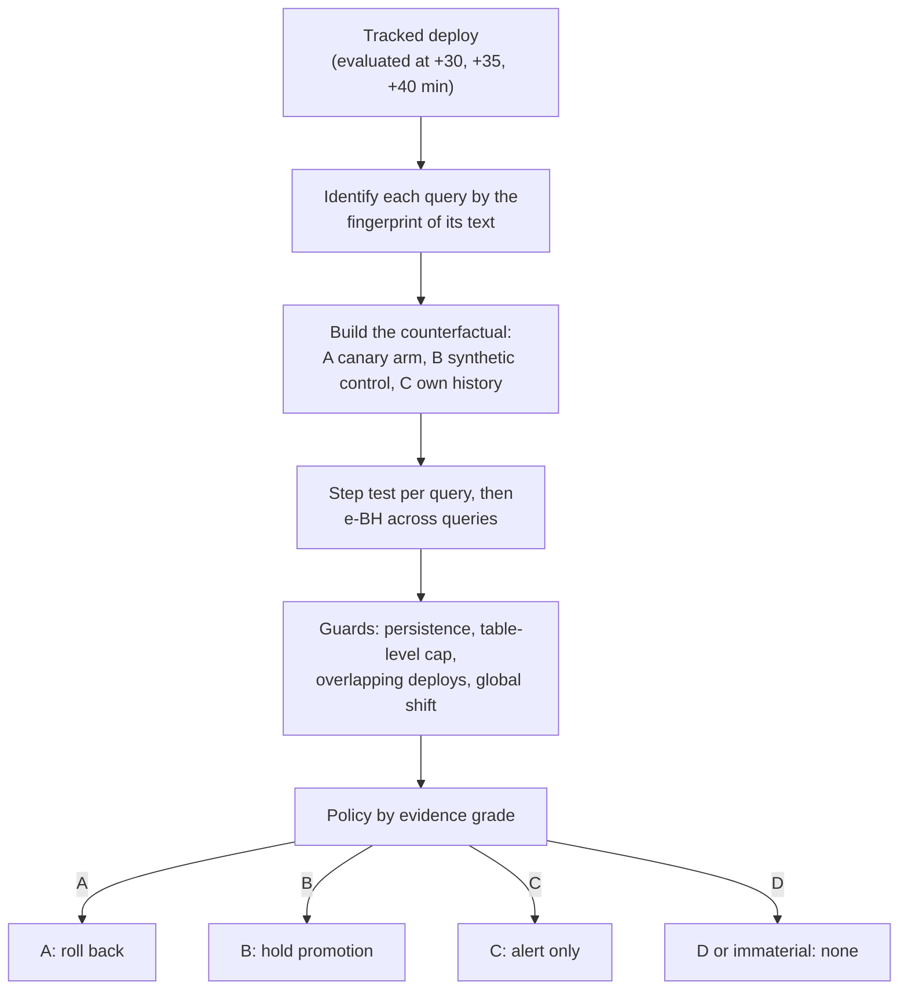

# Attribution engine

*Decide whether a deploy caused a latency change by asking what would have happened without it, and act on how strong that evidence is.*

## Why it exists

A latency change after a deploy is not proof the deploy caused it. A query's `queryid` changes when its text changes, the planner changes plans when statistics refresh, a cache runs cold after a restart, load moves, another deploy lands. Handling each of these with its own rule does not scale. The engine replaces the rules with one question: **what would these queries have done without this deploy, and how sure are we that they did something else?**

The engine judges every tracked deploy and, by default, only records the action it would take (**shadow mode**). In **enforce mode** it serves a verdict that your rollout controller acts on; the manager itself never writes to a Rollout. Turn it on per watch:

```yaml
apiVersion: radar.pgregressionradar.io/v1alpha1
kind: PostgresWatch
spec:
  attribution:
    enabled: true
    mode: shadow   # or "enforce"
```

Decisions appear in the manager log (`attribution (shadow): decision, not executed`, or `attribution (enforce): verdict served…`) and in the metric `pg_regression_radar_attribution_shadow_decisions_total{action,grade}`. It requires the watch to scrape its own collector (not a Prometheus sample source).



## Acting on a verdict

The manager does not patch Rollouts. It serves a read-only verdict and the progressive-delivery controller acts on it, which is how Argo Rollouts and Flagger are designed to take an outside signal: Argo's analysis passes, fails (aborting the rollout) or is inconclusive (pausing it at its current step), and a Flagger webhook that does not return 2xx halts promotion. This also means the manager needs no new RBAC.

Start the manager with `--attribution-verdict-addr=:8082` (off by default; only the leader serves it) and expose that port with a Service. The endpoint is `GET /api/v1/attribution/verdict?namespace=<ns>&app=<name>[&revision=<rev>]`:

```json
{"verdict":"inconclusive","enforced":true,"wouldBe":"inconclusive","action":"hold","grade":"B","impact":0.12,"attribution":1,"reasons":["grade B evidence supports 12.0% added database time"]}
```

| `verdict` | Meaning | Argo Rollouts effect |
|-----------|---------|----------------------|
| `pass` | Nothing to act on, no evaluation yet, unknown deploy, shadow mode, or an alert-only grade | Rollout continues |
| `inconclusive` | Grade B evidence of a material regression, confirmed twice | Rollout pauses at its step |
| `fail` | Grade A evidence (a concurrent control arm), confirmed twice | Rollout aborts |

Anything that cannot be decided is `pass`: the engine never blocks a release for lack of data. In shadow mode `verdict` is always `pass`, and `wouldBe` shows what enforce mode would have said.

An Argo Rollouts analysis that uses it:

```yaml
apiVersion: argoproj.io/v1alpha1
kind: AnalysisTemplate
metadata:
  name: pgrr-attribution
spec:
  args: [{name: namespace}, {name: app}]
  metrics:
    - name: attribution
      interval: 5m
      successCondition: result == 'pass'
      failureCondition: result == 'fail'   # neither condition met = inconclusive = pause
      provider:
        web:
          url: "http://pg-regression-radar.<manager-namespace>.svc:8082/api/v1/attribution/verdict?namespace={{args.namespace}}&app={{args.app}}"
          jsonPath: "{$.verdict}"
```

**Timing matters.** On simulated workloads the engine cannot convict before about 15 minutes after a deploy, because its persistence check needs a late window (transients, such as a cold cache, must have decayed). A canary that is fully promoted in five minutes is out of reach: give the Rollout a pause step of at least 20 minutes, or the verdict arrives after the release is done and can only alert. Compare Flagger, whose rollback time is the analysis interval times its failure threshold, and the Google and Waze advice to run a canary long enough for a meaningful number of data points.

The ladder is the one Google and Waze describe for a new canary analysis: begin with a non-blocking stage, then a manual judgement, and automate only once the analysis has proved reliable. Run shadow mode, compare `wouldBe` with what happened, then set `mode: enforce`. With enforce, the first action you will see is a pause, which one click resumes; an abort needs grade A.

## How it works

1. **Identity.** A query is identified by the fingerprint of its normalised text, never by `queryid`. A rewritten query is a new unit with no history, so it is never judged against a baseline.
2. **Counterfactual.** For each query the engine builds the series it would have had without the deploy, from the best control available, and measures the difference after the deploy.

    | Grade | Control | Needs |
    |-------|---------|-------|
    | A | The same query on the arm the deploy did not reach (canary vs stable), with parallel pre-deploy trends | Samples labelled by arm |
    | B | A synthetic control from queries the deploy did not touch, validated by in-time placebos | At least 5 untouched queries with history |
    | C | The query's own history | Nothing; cannot separate the deploy from anything else |
    | D | Nothing | Not enough data; never blocks |

3. **Inference.** A local-level state-space model with the step estimated inside the Kalman filter, ridge-regressed on the control series. Evidence is an e-process against "no regression beyond the margin" (default 20%), so it is valid at any stopping time, and the false-discovery rate across queries is controlled with e-BH, valid under arbitrary dependence.
4. **Guards.** A persistence test (the shift must still be there after the grace period, so warm-ups do not count), a table-level cap (a shift concentrated on one table that the deploy did not declare is capped at grade C), attribution among overlapping deploys, and a global-shift flag.
5. **Policy.** The action depends on the strongest grade whose supported lower-bound impact reaches the materiality threshold (5% of database time):

    | Evidence | Action |
    |----------|--------|
    | A | Roll back |
    | B | Hold promotion |
    | C | Alert |
    | D or immaterial | None |

    Rollback and hold need two consecutive agreeing evaluations, attribution of at least 0.8, a reversible deploy with a rollback target (a first deploy is held, not rolled back), a cooldown between actions, and a closed circuit breaker. Two actions that did not help open the breaker and the policy only alerts.

## What the test suite shows

Simulated workloads (120 queries, 90 minutes before and 30 after, with load shocks, statistics refreshes, cold caches, rewrites and concurrent deploys), 20 to 60 runs per scenario:

- No change: at most the nominal share of runs flag anything, and none at grade A or B.
- Load shock, statistics refresh, cold cache, rewritten queries, concurrent deploy, below-margin change: no conviction at grade A or B.
- Real regression with a canary arm: about 98% of the affected database time found, no false positives.
- Real regression with synthetic control only: about 94% of the affected database time found, no false positives.
- A first deploy is `InsufficientData`; the policy never blocks on it.

## Limits

- `pg_stat_statements` cannot split canary and stable. Grade A needs arm-labelled data, for example from a Prometheus source; without it the best grade is B.
- A shift shared by every query, with no control arm, is capped at grade C: the engine cannot tell a slower deploy from slower hardware.
- A real regression concentrated on one table, when the deploy does not declare that table, is capped at grade C.
- Table extraction from query text is lexical. A mistake makes queries look related, never invents evidence.
- A pause or abort only helps while the Rollout is still in progress. After a full promotion the verdict can only inform an alert; reverting a promoted release belongs to your GitOps flow.
- Samples from `pg_stat_statements` carry no arm label, so through the collector the best grade is B and the strongest verdict is `inconclusive` (a pause). A `fail` needs a sample source that labels arms.
- The circuit breaker is in the policy, but nothing feeds it a post-action check yet, so it never opens on its own.

## References

- Argo Rollouts documentation: [Analysis & Progressive Delivery](https://argo-rollouts.readthedocs.io/en/stable/features/analysis) and [Rollout specification](https://argo-rollouts.readthedocs.io/en/stable/features/specification/).
- Flagger documentation: [Deployment strategies and webhooks](https://docs.flagger.app/main/usage/deployment-strategies).
- Google Cloud, [Canary analysis: lessons learned and best practices from Google and Waze](https://cloud.google.com/blog/products/devops-sre/canary-analysis-lessons-learned-and-best-practices-from-google-and-waze).
- Brodersen et al., *Inferring causal impact using Bayesian structural time-series models*, Annals of Applied Statistics 2015.
- Abadie, Diamond, Hainmueller, *Synthetic control methods for comparative case studies*, JASA 2010.
- Durbin, Koopman, *Time Series Analysis by State Space Methods*, 2nd ed., section 6.2.4.
- Ramdas, Grünwald, Vovk, Shafer, *Game-theoretic statistics and safe anytime-valid inference*, Statistical Science 2023.
- Wang, Ramdas, *False discovery rate control with e-values*, JRSSB 2022.
- Johari, Koomen, Pekelis, Walsh, *Always valid inference*, Operations Research 2022.
- Howard, Ramdas, McAuliffe, Sekhon, *Time-uniform, nonparametric, nonasymptotic confidence sequences*, Annals of Statistics 2021.
