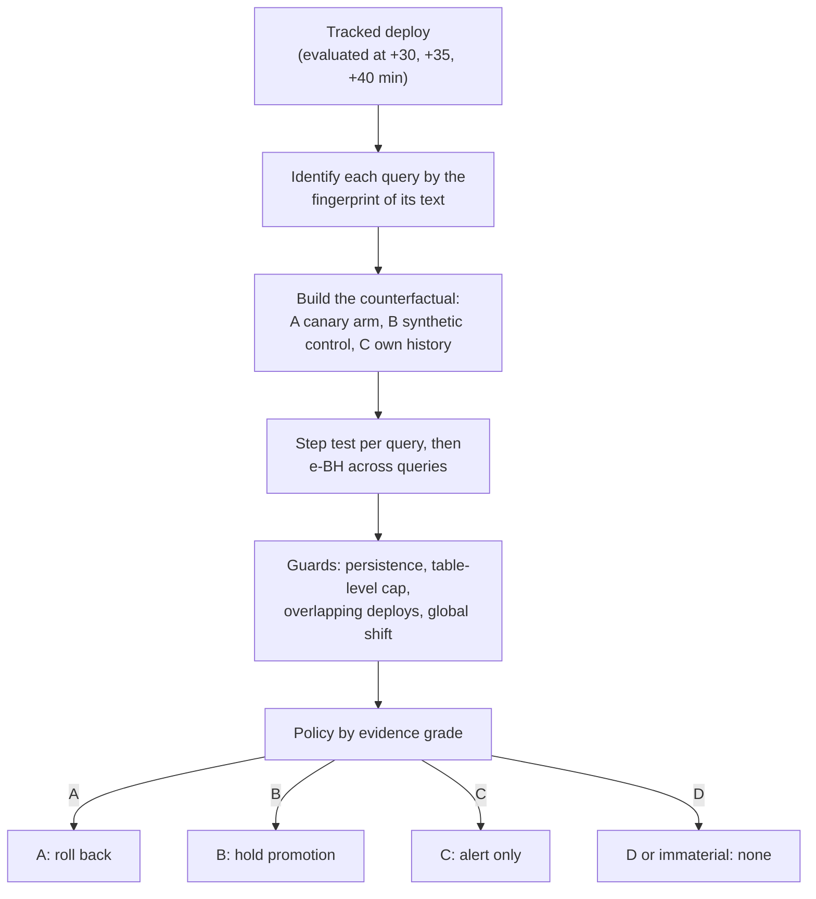

# Attribution engine

*Decide whether a deploy caused a latency change by asking what would have happened without it, and act on how strong that evidence is.*

## Why it exists

A latency change after a deploy is not proof the deploy caused it. A query's `queryid` changes when its text changes, the planner changes plans when statistics refresh, a cache runs cold after a restart, load moves, another deploy lands. Handling each of these with its own rule does not scale. The engine replaces the rules with one question: **what would these queries have done without this deploy, and how sure are we that they did something else?**

The engine judges every tracked deploy and, by default, only records the action it would take (**shadow mode**). In **enforce mode** it serves a verdict that your rollout controller acts on; the manager itself never writes to a Rollout. Turn it on per watch:

```yaml
apiVersion: radar.pgregressionradar.io/v1alpha1
kind: PostgresWatch
spec:
  attribution:
    enabled: true
    mode: shadow   # or "enforce"
```

Decisions appear in the manager log (`attribution (shadow): decision, not executed`, `attribution (enforce): verdict served…` when a decision is enforced, or `attribution (enforce): decision below the acting threshold…` for an alert or nothing in enforce mode) and in the metric `pg_regression_radar_attribution_shadow_decisions_total{action,grade}`. It requires the watch to scrape its own collector (not a Prometheus sample source).



## Acting on a verdict

By default the manager does not patch Rollouts. It serves a read-only verdict and the progressive-delivery controller acts on it, which is how Argo Rollouts and Flagger are designed to take an outside signal (to have the manager act itself, see [Letting the manager act](#letting-the-manager-act)): Argo's analysis passes, fails (aborting the rollout) or is inconclusive (pausing it at its current step), and a Flagger webhook that does not return 2xx halts promotion. On this path the manager needs no new RBAC.

Start the manager with `--attribution-verdict-addr=:8082` (off by default; only the leader serves it) and expose that port with a Service. The endpoint is `GET /api/v1/attribution/verdict?namespace=<ns>&app=<name>[&revision=<rev>]`:

```json
{"verdict":"inconclusive","enforced":true,"wouldBe":"inconclusive","action":"hold","grade":"B","impact":0.12,"attribution":1,"reasons":["grade B evidence supports 12.0% added database time"]}
```

| `verdict` | Meaning | Argo Rollouts effect |
|-----------|---------|----------------------|
| `pass` | Nothing to act on, no evaluation yet, unknown deploy, shadow mode, or an alert-only grade | Rollout continues |
| `inconclusive` | Grade B evidence of a material regression, confirmed twice | Rollout pauses at its step |
| `fail` | Grade A evidence (a concurrent control arm), confirmed twice | Rollout aborts |

Anything that cannot be decided is `pass`: the engine never blocks a release for lack of data. In shadow mode `verdict` is always `pass`, and `wouldBe` shows what enforce mode would have said.

An Argo Rollouts analysis that uses it:

```yaml
apiVersion: argoproj.io/v1alpha1
kind: AnalysisTemplate
metadata:
  name: pgrr-attribution
spec:
  args: [{name: namespace}, {name: app}]
  metrics:
    - name: attribution
      interval: 5m
      successCondition: result == 'pass'
      failureCondition: result == 'fail'   # neither condition met = inconclusive = pause
      provider:
        web:
          url: "http://pg-regression-radar.<manager-namespace>.svc:8082/api/v1/attribution/verdict?namespace={{args.namespace}}&app={{args.app}}"
          jsonPath: "{$.verdict}"
```

**Timing matters.** On simulated workloads the engine cannot convict before about 15 minutes after a deploy, because its persistence check needs a late window (transients, such as a cold cache, must have decayed). A canary that is fully promoted in five minutes is out of reach: give the Rollout a pause step of at least 20 minutes, or the verdict arrives after the release is done and can only alert. Compare Flagger, whose rollback time is the analysis interval times its failure threshold, and the Google and Waze advice to run a canary long enough for a meaningful number of data points.

The ladder is the one Google and Waze describe for a new canary analysis: begin with a non-blocking stage, then a manual judgement, and automate only once the analysis has proved reliable. Run shadow mode, compare `wouldBe` with what happened, then set `mode: enforce`. With enforce, the first action you will see is a pause, which one click resumes; an abort needs grade A.

A copy-and-adapt walk-through is in [Example: pausing a bad rollout](examples/attribution-rollout.md), and [Troubleshooting](troubleshooting.md#the-attribution-engine-only-alerts-or-does-not-act) explains why a deploy might only alert.

## Letting the manager act

The verdict endpoint needs a rollout controller that asks. When you want the radar to act on its own, with no `AnalysisTemplate` in between, turn on actuation:

```yaml
spec:
  attribution:
    enabled: true
    mode: enforce
    actuate:
      enabled: true
      namespaces: [shop, payments]   # optional; empty means any
```

It follows the same ladder as the verdict, and only for a deploy that a [`DeploySource`](webhooks.md) of type `argo-rollouts` reported:

| Engine action | What the manager does | Same as |
|---|---|---|
| `hold` (grade B, confirmed twice, material) | sets `spec.paused: true` on the Rollout | `kubectl argo rollouts pause` |
| `rollback` (grade A, confirmed twice) | sets `status.abort: true` on the Rollout | `kubectl argo rollouts abort` |
| anything else | nothing | |

It never resumes, rolls back to a revision, scales, or deletes: a pause or an abort stops a bad rollout where it is, and a person decides what comes next. Each action is taken at most once per deploy, a pause can escalate to an abort if later evidence is stronger, and a failed call is retried at the next evaluation. Every attempt is counted in `pg_regression_radar_attribution_actions_total{action,result}` (`result` is `done`, `failed` or `skipped`) and logged with the grade, the impact and the reasons.

Every attempt is also written to an in-memory ledger, served newest first at `GET /api/v1/attribution/actions` (same port as the verdict endpoint; filter with `?namespace=` and `?app=`): the time, the deploy, `pause` or `abort`, and the result with its reason. It also reports `breakerOpen`. The ledger keeps the last 200 entries and is lost on a restart; the metrics and the logs are the durable record.

```json
{"breakerOpen":false,"actions":[
 {"at":"2026-11-24T14:41:00Z","deployId":"d1","namespace":"shop","app":"checkout","action":"abort","result":"recovered","detail":"regression no longer supported after the action"},
 {"at":"2026-11-24T14:26:00Z","deployId":"d1","namespace":"shop","app":"checkout","action":"abort","result":"done","detail":"grade A evidence supports 12.0% added database time"}]}
```

**Checking that it helped.** Fifteen minutes after an abort the engine reads the deploy again. It leaves out what the deploy did until the abort (and three minutes more for the canary's pods to drain) and reads what came after, so a canary that ran slow before it was stopped does not count against the abort; a canary that is still serving does. If the regression is gone the result is `recovered`. If it is still supported at grade B or better, the abort did not help (the deploy was not the cause, or the abort did not take) and the result is `persisted`. When there is too little data after the abort to judge by, no check is made and nothing counts. Each `persisted` counts as a failure for the policy; after two in a row (`BreakerLimit`) the circuit breaker opens and the engine only alerts, until the manager restarts. `pg_regression_radar_attribution_breaker_open` is `1` while it is open, and `pg_regression_radar_attribution_verifications_total{result}` counts the checks. A pause is not checked: a held canary keeps serving traffic, so its regression persists by design.

Four rules keep it safe to turn on:

- **Enforce mode only.** In shadow mode nothing is written; the log says what would have been done.
- **One detector acts.** While `actuate` is on, the older `spec.autoAbort` trigger is ignored for that watch, so one regression is never acted on twice by two detectors that disagree. The engine's guards (material impact, two consecutive confirmations, attribution of at least 0.8, a cooldown) apply to every action.
- **You can bound it and stop it.** `actuate.namespaces` limits it to Rollouts in the listed namespaces (empty means any); a deploy elsewhere is still judged and logged, and the ledger records it as `skipped`. To stop all pausing and aborting at once, with no restart and no spec change, annotate the watch: `kubectl annotate postgreswatch <name> pg-regression-radar.io/actuation-paused=true` (remove the annotation to resume). If the watch cannot be read at that moment, the manager assumes it is paused.
- **It needs the Rollout RBAC.** Set `manager.autoAbort.rbacEnabled: true` in the Helm chart (it grants `patch` on `rollouts` and `rollouts/status`). Without it, or without `mode: enforce`, `actuate` is ignored and the log says why.

Through the collector alone the best evidence is grade B, because `pg_stat_statements` carries no label saying which release served a call, so the manager pauses and a person aborts; an abort needs grade A evidence, which [`attribution.arms`](#telling-a-canary-from-the-stable-pods-grade-a) provides. The [timing note](#acting-on-a-verdict) applies here too: the engine cannot convict before about 15 minutes, so the Rollout needs a pause step of at least 20 minutes for the action to land in time.

## Telling a canary from the stable pods (grade A)

`pg_stat_statements` mixes every client together, so through the collector alone the best evidence is grade B and the strongest action is a pause. To abort, the engine needs to see the canary and the stable pods **at the same time**. It gets that from the Postgres log, which records for each statement the `application_name` of the session that ran it. Nothing is installed on the server: it takes core settings, and no extension.

```yaml
spec:
  attribution:
    enabled: true
    mode: enforce
    actuate: {enabled: true}
    arms:
      enabled: true
      podLogs:                       # Postgres in the cluster (CloudNativePG, a StatefulSet)
        namespace: db
        selector: cnpg.io/cluster=pg
      # file: /var/log/postgresql/postgresql.json   # or a log file the manager can open
```

What you set up:

1. **The server.** `compute_query_id = on`, `log_destination = 'jsonlog'` (PostgreSQL 15 or newer), `log_min_duration_sample = 0`, `log_min_duration_statement = -1` (or leave a slow-query log on: the engine weights for it), and a small `log_statement_sample_rate`, for example `0.05`. The manager reads these settings itself every five minutes and logs exactly which one is wrong. The log is not used until they pass. A rate above 0.25 only draws a warning, because it costs the database and the log pipeline.
2. **The application.** Every pod must report an `application_name` that **begins with the pod's name** (`<rollout>-<pod-template-hash>-<suffix>`), which is the hostname. With an Argo Rollouts workload, set `PGAPPNAME` from the pod's own name:

   ```yaml
   env:
   - name: PGAPPNAME
     valueFrom: {fieldRef: {fieldPath: metadata.name}}
   ```

   The manager reads the Rollout's `status.stableRS` and `status.currentPodHash`, so the pods of the new version are the treatment and the pods of the old version the control. A pod that does not follow the naming is simply not counted; if none do, the engine behaves as it does without `arms`.
3. **The manager.** `podLogs` needs `manager.arms.rbacEnabled: true` in the chart (get and list on pods, get on `pods/log`). `file` needs nothing. Reading Rollouts needs `manager.autoAbort.rbacEnabled`, as for `actuate`.

How the evidence is built:

- The manager keeps, per `application_name` and `query_id`, the number of sampled executions and their mean duration in each scrape interval. It joins a log line to a collected query by `query_id`. It never keeps the statement text or the bind parameters, which can hold personal data, and a line longer than 1 MiB is skipped.
- Each sampled execution is weighted by the inverse of its chance of being logged, so the mean stays unbiased when slow statements are always logged (a slow-query log) and fast ones only sampled. The weight of a mean is the number of samples behind it, not the number of calls they stand for.
- **Before the deploy there is no canary**, so the old version's pods are split in two alternating halves and one half stands in for the canary. The ratio of treatment to control is therefore flat by construction before the deploy; after it, the canary pods are the treatment and the old pods the control. A step in that ratio at the deploy time, which also passes the engine's placebo tests at fake deploy times, is grade A.
- When the log is not flowing (no line for five minutes), its settings fail, the Rollout is already promoted (stable and current hash are equal), or the Rollout cannot be read, the evaluation falls back to what `pg_stat_statements` supports.

Two things decide how much a canary check can see: the traffic the canary receives and the sample rate. The number that matters is the sampled executions per minute the canary produces for a query: with only a handful, the engine cannot tell a regression from noise and says nothing, which is safe but silent. The Prometheus metrics `pg_regression_radar_attribution_arms_usable`, `..._arms_records_total` and `..._arms_dropped_total` say whether the log is usable and flowing.

### What a real test showed

The arm reader was run twice against seven PostgreSQL 16 servers (four stable pods and one canary pod per server, a real Kubernetes API server with the Argo Rollouts CRD, the manager in `enforce` mode with `actuate`, a canary at about 15% of the traffic, evaluations from 10 minutes after the deploy). The canary regression was a query that runs without its index in the canary only.

| Case | Round 1 | Round 2 |
|---|---|---|
| Canary regression, every statement logged (about 26 sampled executions a minute for the query) | grade A at +15 min | grade A at +15 min, **abort** at +20 min |
| Canary regression, sample rate 0.2 (about 5 a minute) | grade A at +15 min | grade A at +15 min, **abort** at +20 min |
| Canary regression, sample rate 0.05 (about 1 a minute) | grade A at +15 min | **missed**: stayed at grade C, alert only |
| Canary identical to stable (A/A) | no action | no action |
| A/A while a shared load shock hit both arms | no action | no action |
| One stable pod degraded, canary healthy | no action | no action |
| `application_name` not following the pod name | alert only (grade C) | alert only (grade C) |

Read it for what it is: two rounds of seven scenarios, one workload, a 2-core machine. It shows that the mechanism works end to end and that no control case acted; it is not a rate. The one miss is the expected limit: at about one sampled execution a minute the canary leaves too little to tell a regression from noise, so choose a sample rate that gives the canary at least a handful of sampled executions a minute for the queries you care about (rate x canary traffic x the query's share). Round 1 also paused instead of aborting because the test had registered no earlier deploy, and the engine never aborts a first deploy. In round 2 the verification 15 minutes after each abort recorded `persisted` (the regression was still there), because nothing in the test acts on an abort: no rollout controller scales the canary down. The engine kept judging the deploy a rollback but did not patch the Rollout a second time, and the persisted check counts toward the circuit breaker, as designed.

## Reverting a convicted deploy

Pausing a rollout only helps while it is running. For a release that is already promoted, the durable fix is a revert in git: with Argo CD's automated sync on, Argo CD cannot roll the application back ("Rollback cannot be performed against an application with automated sync enabled"), and anything changed directly in the cluster is undone by the next sync. So in enforce mode the radar can open a **draft pull request that reverts the change**, and leave the decision to a person.

```yaml
spec:
  attribution:
    enabled: true
    mode: enforce
    revert:
      enabled: true
      repository: my-org/my-deploy-repo
      tokenSecretRef: {name: github-token, key: token}
      maxPerDay: 3
      includeQueryText: false
```

It acts when the policy holds at hold or above (grade B or better, confirmed twice, material, attributed to this deploy). It then:

1. Takes the deploy's revision, which must be a full 40-character commit SHA. An Argo CD source reports one; an Argo Rollouts source reports a pod hash and a tag is not a commit, so those are refused, not guessed at.
2. Checks that no pull request for this deploy exists yet (a marker line `pgrr-revert-id: <deploy id>` is searched for, so a restart or a leader change does not open a second one).
3. Finds the pull request whose merge commit is that SHA, merged into the default branch. A direct push, or a commit that is not the merge commit of a pull request, is refused.
4. Asks GitHub to create the revert (the GraphQL `revertPullRequest` mutation, which "creates a pull request that reverts the changes from a merged pull request"), as a draft, with a body that gives the grade, the lower-bound added database time, the attribution, the most affected queries, and what to check before merging: database migrations, other changes in the same commit, and a warning if the radar has not seen an earlier deploy of the app.

What keeps this safe:

- **It never merges.** The pull request is always a draft and a person reviews it. That is the one safeguard that does not depend on the statistics being right.
- **Once per deploy, and at most `maxPerDay` (default 3) per watch**, so a bad day cannot bury a repository.
- **Query text is off by default.** The body shows fingerprints and ratios. Turn on `includeQueryText` only if the repository is private, since a query's text names tables and columns. Everything written into the body is stripped of markdown, mentions and issue references.
- **The token** comes from a Secret that carries the same consent label as every other Secret a PostgresWatch references (`pg-regression-radar.io/allow-postgreswatch-access=true`). It is read for each use and not kept, it is only sent to the configured API host, which must be https, and a redirect is never followed with it attached. Use a fine-grained token limited to that one repository. The documentation I read does not state which permissions `revertPullRequest` needs; start with Pull requests and Contents, both read and write, and check that against your GitHub.
- **In shadow mode nothing is called.** The log says which pull request would have been opened.

Metric: `pg_regression_radar_attribution_revert_proposals_total{result}` with `opened`, `already-proposed`, `skipped` and `failed`.

Limits: a failed attempt is retried at the next evaluation, and the search that finds an earlier pull request lags by a short while after one is opened, so a restart within that window can, rarely, open a second draft. A revert does not undo a database migration that shipped with the change.

## How it works

1. **Identity.** A query is identified by the fingerprint of its normalised text, never by `queryid`. A rewritten query is a new unit with no history, so it is never judged against a baseline.
2. **Counterfactual.** For each query the engine builds the series it would have had without the deploy, from the best control available, and measures the difference after the deploy.

    | Grade | Control | Needs |
    |-------|---------|-------|
    | A | The same query on the arm the deploy did not reach (canary vs stable), with parallel pre-deploy trends | Samples labelled by arm |
    | B | A synthetic control from queries the deploy did not touch, validated by in-time placebos | At least 5 untouched queries with history |
    | C | The query's own history | Nothing; cannot separate the deploy from anything else |
    | D | Nothing | Not enough data; never blocks |

    A control query must have data for at least half of the pre-deploy window (45 of the 90 minutes), so after a manager restart the evidence stays at grade C, an alert, until about 45 minutes of history have been collected. Hold and pause are not available before then.

3. **Inference.** A local-level state-space model with the step estimated inside the Kalman filter, ridge-regressed on the control series. Evidence is an e-process against "no regression beyond the margin" (default 20%), so it is valid at any stopping time, and the false-discovery rate across queries is controlled with e-BH, valid under arbitrary dependence.
4. **Guards.** A persistence test (the shift must still be there after the grace period, so warm-ups do not count), a table-level cap (a shift concentrated on one table that the deploy did not declare is capped at grade C), attribution among overlapping deploys, and a global-shift flag. The global-shift flag only counts untouched units that moved the same way as the unit under test: a slow query that throttles a closed-loop workload makes the other queries faster, and that is not a cause shared with the regression.

    When the evidence stops at grade C, the decision says why (`evidence is capped at grade C by: global-shift (3), few-donors (1)`), in the log and in the verdict's reasons.
5. **Policy.** The action depends on the strongest grade whose supported lower-bound impact reaches the materiality threshold (5% of database time):

    | Evidence | Action |
    |----------|--------|
    | A | Roll back |
    | B | Hold promotion |
    | C | Alert |
    | D or immaterial | None |

    Rollback and hold need two consecutive agreeing evaluations, attribution of at least 0.8, a reversible deploy with a rollback target (a first deploy is held, not rolled back), a cooldown between actions, and a closed circuit breaker. Two actions that did not help open the breaker and the policy only alerts.

## What the test suite shows

Simulated workloads (120 queries, 90 minutes before and 30 after, with load shocks, statistics refreshes, cold caches, rewrites and concurrent deploys), 20 to 60 runs per scenario:

- No change: at most the nominal share of runs flag anything, and none at grade A or B.
- Load shock, statistics refresh, cold cache, rewritten queries, concurrent deploy, below-margin change: no conviction at grade A or B.
- Real regression with a canary arm: about 98% of the affected database time found, no false positives.
- Real regression with synthetic control only: about 94% of the affected database time found, no false positives.
- A first deploy is `InsufficientData`; the policy never blocks on it.

## Limits

- `pg_stat_statements` cannot split canary and stable. Grade A needs arm-labelled data, which `attribution.arms` reads from the Postgres log; without it the best grade is B.
- A shift shared by every query, with no control arm, is capped at grade C: the engine cannot tell a slower deploy from slower hardware.
- A real regression concentrated on one table, when the deploy does not declare that table, is capped at grade C.
- Table extraction from query text is lexical. A mistake makes queries look related, never invents evidence.
- A pause or abort only helps while the Rollout is still in progress. After a full promotion the verdict can only inform an alert; reverting a promoted release belongs to your GitOps flow.
- Without `attribution.arms` the samples from `pg_stat_statements` carry no arm label, so the best grade is B and the strongest verdict is `inconclusive` (a pause). A `fail` needs the arms.
- `attribution.arms` assumes the pod name is the `application_name`, a Postgres 15 or newer JSON log, and a canary that receives enough traffic to leave samples; it was tested against PostgreSQL 16 logs read from a file, and the CloudNativePG log wrapper is unwrapped as documented but has not been run against a live CloudNativePG cluster.
- The revert proposal needs the deploy's revision to be a git commit SHA: Argo CD sources qualify, Argo Rollouts sources (a pod hash) do not.
- The circuit breaker is fed only by the check after an abort. A pause cannot be checked (a held canary keeps serving traffic, so its regression persists by design) and a revert pull request is not checked yet, so neither can open it.

## References

- Argo Rollouts documentation: [Analysis & Progressive Delivery](https://argo-rollouts.readthedocs.io/en/stable/features/analysis) and [Rollout specification](https://argo-rollouts.readthedocs.io/en/stable/features/specification/).
- Flagger documentation: [Deployment strategies and webhooks](https://docs.flagger.app/main/usage/deployment-strategies).
- Argo CD documentation: [Automated sync policy](https://argo-cd.readthedocs.io/en/release-3.0/user-guide/auto_sync/). GitHub documentation: [GraphQL pull request mutations](https://docs.github.com/en/graphql/reference/pulls) and [REST: list pull requests associated with a commit](https://docs.github.com/en/rest/commits/commits).
- Google Cloud, [Canary analysis: lessons learned and best practices from Google and Waze](https://cloud.google.com/blog/products/devops-sre/canary-analysis-lessons-learned-and-best-practices-from-google-and-waze).
- Brodersen et al., *Inferring causal impact using Bayesian structural time-series models*, Annals of Applied Statistics 2015.
- Abadie, Diamond, Hainmueller, *Synthetic control methods for comparative case studies*, JASA 2010.
- Durbin, Koopman, *Time Series Analysis by State Space Methods*, 2nd ed., section 6.2.4.
- Ramdas, Grünwald, Vovk, Shafer, *Game-theoretic statistics and safe anytime-valid inference*, Statistical Science 2023.
- Wang, Ramdas, *False discovery rate control with e-values*, JRSSB 2022.
- Johari, Koomen, Pekelis, Walsh, *Always valid inference*, Operations Research 2022.
- Howard, Ramdas, McAuliffe, Sekhon, *Time-uniform, nonparametric, nonasymptotic confidence sequences*, Annals of Statistics 2021.
