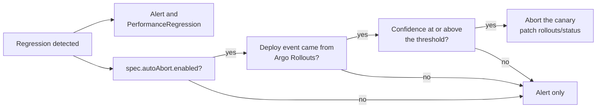

# Auto-Abort (Argo Rollouts)

*Closing the loop between detecting a regression and doing something about it — safely, and only when asked.*

## Overview

By default, this project only ever alerts: the Correlation Engine detects a regression, `internal/alerting` sends it to Slack, and a `PerformanceRegression` CR records it. A human still has to read the alert and decide whether to abort the deploy.

`PostgresWatch.spec.autoAbort` optionally closes that loop for one specific, well-understood case: a canary rollout managed by [Argo Rollouts](https://argo-rollouts.readthedocs.io/). When a regression tied to an Argo Rollouts deploy clears a confidence bar you configure, this manager aborts the canary itself — the same effect `kubectl argo rollouts abort` has — instead of waiting for someone to see the alert.

This is opt-in at every level, on purpose:

- Disabled by default. `spec.autoAbort` is `nil` unless you set it.
- Per-`PostgresWatch`. Enabling it for one watched Postgres cluster doesn't affect any other.
- Scoped to Argo Rollouts only. A regression whose deploy event came from an `argocd`, `flux`, `generic`, or `kubernetes` [DeploySource](webhooks.md) is never auto-aborted, regardless of `spec.autoAbort.enabled` or confidence — none of those has an equivalent "abort mid-rollout" primitive to call, and ArgoCD's/Flux's own notion of "rollback" (re-syncing to a previous Git revision) is a materially bigger, more destructive action than pausing a canary, so it's deliberately out of scope here.
- Gated behind its own RBAC. See [RBAC](#rbac) below — a cluster that never sets `spec.autoAbort.enabled` doesn't need to grant this manager any access to Argo Rollouts at all.
- A higher confidence bar than ordinary alerting. See [Confidence threshold](#confidence-threshold).



*The alert is always sent. Aborting needs three conditions on top, and the manager also needs the optional Argo Rollouts RBAC.*

## Configuration

```yaml
apiVersion: radar.pgregressionradar.io/v1alpha1
kind: PostgresWatch
metadata:
  name: prod-db
spec:
  clusterName: prod
  dsnSecretRef: {name: prod-db-dsn, key: dsn}
  autoAbort:
    enabled: true
    confidenceThreshold: "0.99"   # optional; this is the default
```

| Field | Default | Description |
|---|---|---|
| `enabled` | `false` | Turns on automatic abortion for this watch. |
| `confidenceThreshold` | `"0.99"` | Minimum `confidenceScore` (`1 - pValue`, so `"0.99"` means `pValue <= 0.01`) required before aborting, on top of already having cleared `pValueThreshold` to be reported as `Detected` at all. |

## Confidence threshold

A regression is already reported as `Detected` once its p-value clears `spec.pValueThreshold` (default `0.05`, i.e. `confidenceScore` ≥ `0.95`; a significance score, not a probability that the regression is real — see [what the confidence score means](detection-algorithm.md#what-the-p-value-and-the-confidence-score-mean)). `autoAbort.confidenceThreshold` defaults higher, at `0.99`, deliberately: alerting a human on a `0.95`-confidence signal costs nothing but their attention, but automatically aborting a production canary on the same signal is a more consequential action, and false positives are more expensive to get wrong in that direction. Set `confidenceThreshold` explicitly if your workload's noise profile calls for something other than the default — it must be a value the `Welch's t-test` p-value can plausibly clear; see [Detection Algorithm](detection-algorithm.md) for how confidence is computed.

## What actually gets changed

`ArgoRolloutsAborter` (`internal/actuation`) does exactly one thing: a merge patch setting `status.abort: true` on the `Rollout` object named after the deploy event's app, in the deploy event's namespace — the same field `kubectl argo rollouts abort` sets, which causes Argo Rollouts' own controller to stop the canary in place. It does not:

- Delete, scale, or otherwise mutate anything else about the `Rollout`.
- Roll back to a previous revision (that's `kubectl argo rollouts undo`, a separate, bigger decision left to whoever operates the Rollout).
- Touch any other Kubernetes object.

The outcome is recorded on the `PerformanceRegression`'s status — `autoAbortTriggered` (an attempt was made) and, if it failed, `autoAbortError` — so `kubectl get performanceregressions` and the Slack alert both show what happened, not just that a regression was detected.

## RBAC

Auto-abort needs the manager's ServiceAccount to reach `Rollout` objects, which is not part of this project's default RBAC (see [Configuration Reference](configuration.md)). Via the Helm chart, set:

```yaml
manager:
  autoAbort:
    rbacEnabled: true
```

which grants exactly:

```yaml
- apiGroups: ["argoproj.io"]
  resources: ["rollouts", "rollouts/status"]
  verbs: ["get", "patch"]
```

Leave this `false` (the default) on any cluster that doesn't use Argo Rollouts, or where no `PostgresWatch` sets `spec.autoAbort.enabled` — there's no reason to grant it otherwise. Outside Helm (e.g. `config/rbac/role.yaml` for a `kustomize`-based install), the equivalent rule is already present unconditionally; remove it if you don't need it.

If `cmd/manager` can't build a Kubernetes dynamic client at startup for any reason, it logs the failure and continues with auto-abort unavailable — every `PostgresWatch.spec.autoAbort.enabled` is treated as `false` regardless of what the CR says, and everything else (detection, alerting, the webhook/native-watch ingestion paths) is unaffected.

## Where this is heading

Auto-abort acts on a confidence score from the detector, which says a query changed near the deploy, not that the deploy caused it. The [attribution engine](attribution-engine.md) is the groundwork for acting on stronger evidence: it grades each finding by how good its control is and only calls for a rollback at grade A (a concurrent control arm). It runs in shadow mode and does not change what auto-abort does today.

## See also

- [Attribution engine](attribution-engine.md) — the evidence grades a future rollback decision would be keyed on.
- [Deploy Sources & Webhooks](webhooks.md) — the `sourceType: argo-rollouts` `DeploySource` that must be feeding the target `PostgresWatch` for auto-abort to ever have anything to act on.
- [Detection Algorithm](detection-algorithm.md) — how `confidenceScore`/`pValueThreshold` are computed.
- [Configuration Reference](configuration.md) — the full `PostgresWatch` spec field table.
