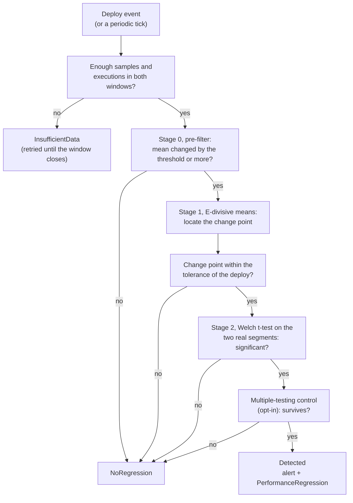

# Detection Algorithm

*The two-stage statistics behind every `PerformanceRegression`, why both stages have to agree, and how a regression gets a plan-diff attached.*

## Overview

The Correlation Engine (`internal/correlation`) doesn't just compare a before/after mean — a naive comparison alone is prone to false positives whenever an unrelated latency shift happens to overlap the analysis window. This page explains the real two-stage pipeline it runs instead, inspired by [Hunter — DataStax Labs](https://github.com/datastax-labs/hunter) and the accompanying ICPE'23 paper, ["Hunter: Using Change Point Detection to Hunt for Performance Regressions"](https://arxiv.org/abs/2301.03034).



*A query is reported only when every gate agrees: precision over recall.*

## What a latency sample is

`pg_stat_statements` does not report the latency of the last scrape interval. `calls` and `total_exec_time` are counters that accumulate from the last reset, and `mean_exec_time` is their ratio, an average over the query's whole history. Feeding that value to a change-point test hides regressions: after a million calls at 10 ms, a query that becomes 5x slower for fifteen minutes moves the all-time mean from 10.0 ms to about 10.4 ms. A reset has the opposite effect and shows up as a step in the series that looks like a latency change.

The Collector therefore calculates the activity since the previous snapshot of each `(dbid, userid, queryid, toplevel)` row, then combines those intervals per `queryid`:

```text
row interval calls = calls_now - calls_prev
row interval time  = total_exec_time_now - total_exec_time_prev
query interval mean = sum(row interval time) / sum(row interval calls)
```

The engine runs its statistics on this series:

- **Interval means are the series.** Stage 1 and stage 2 read the per-interval mean. The reported `MeanLatencyBefore`/`MeanLatencyAfter` are total time over total calls in each window, so busy intervals weigh more than quiet ones.
- **Intervals with no calls are dropped.** They carry no latency information. The first scrape of a `queryid`, a changed set of constituent rows, or an expired predecessor leaves an unknown interval, which is dropped too. Unknown collector intervals never fall back to cumulative-mean analysis. `--min-samples` and `--min-executions` are checked against what remains, see [Minimum samples and minimum executions](#minimum-samples-and-minimum-executions).
- **Resets are detected, not trusted.** The counters are considered restarted when `calls` or `total_exec_time` decreases (`pg_stat_statements_reset()`, a crash, or eviction once `pg_stat_statements.max` is exceeded), or, on PostgreSQL 17+, when `stats_since` changes. The second signal also catches a reset whose counters have already climbed past their old values by the next scrape. After a reset the counters start from zero, so the new values are the activity since the reset and are used as that interval. Each detection increments `pg_regression_radar_collector_stats_resets_detected_total`.
- **History survives restarts.** New persisted samples retain the calculated interval fields and their known/unknown state. `Backfill` preserves them instead of subtracting aggregate cumulative counters, which would mishandle independent row resets. Old cumulative-only records keep the legacy reconstruction behavior; missing row identities cannot be recovered retroactively. The first live scrape after restart establishes fresh row baselines.

Reset detection happens per row before aggregation. The aggregate marks a reset if any constituent row reset; its other rows still contribute only their own increments. See [Collector Internals](collector-internals.md#row-identity-before-aggregation) for the 500-row selection limit and row-membership changes.

The collector also exports the latest value as `pg_regression_radar_query_interval_mean_exec_time_ms{queryid}`.

Samples that carry no interval data (a source that only exposes a mean, such as the [OTel/Prometheus source](otel-prometheus-source.md)) are analysed on that value as before. For that source, the configured metric must already be a per-interval mean.

Limits: the series is made of interval means, so the t-test measures variation between scrape intervals, not between individual calls, and a long gap between scrapes yields one interval that spans the gap. Per-call variance (`stddev_exec_time`) is not used yet.

## Minimum samples and minimum executions

Two floors, applied to each of the pre- and post-deploy windows, decide whether a query has enough data for a verdict. A query that misses either one is reported as `InsufficientData` and, for deploy-triggered analysis, retried until the window closes.

| Floor | Flag | Default | Counts |
|---|---|---|---|
| Samples | `--min-samples` | `10` | Observations: scrape intervals in which the query ran at least once. |
| Executions | `--min-executions` | `100` | Calls to the query, summed over those observations. |

They protect different things, which is why one number cannot do both jobs. Ten observations may be ten calls or ten million, and neither tells you how well the window's mean latency is known.

**Samples** protect the machinery. E-divisive means and Welch's t-test estimate a spread from the observations themselves, so they need enough points to do it. The R `ecp` package, the reference implementation of E-divisive means ([Matteson and James, 2014](https://doi.org/10.1080/01621459.2013.849605)), defaults to a minimum of 30 observations between change points; MongoDB's production deployment of the same method ([Daly et al., ICPE 2020](https://arxiv.org/abs/2003.00584)) lowered it to 3 in exchange for faster notification. The default of 10 sits between them and matches what `--min-executions` effectively enforced before the two were separated.

**Executions** protect the precision of the mean. The standard error of a mean of N calls is CV / sqrt(N), where CV is the coefficient of variation of per-call latency. To detect a relative change of delta with 5% significance and 80% power, each window needs roughly

```text
N = 2 * (1.96 + 0.84)^2 * CV^2 / delta^2  ~=  15.7 * CV^2 / delta^2
```

| Relative change to detect | CV = 1 | CV = 2 |
|---|---|---|
| 20% (the default `--latency-threshold`) | ~390 | ~1,570 |
| 30% | ~175 | ~700 |
| 50% | ~63 | ~250 |

Below that, the test is not wrong, it is underpowered: a "no regression" verdict would mean "could not tell". The default of 100 is a floor under which a verdict is not worth reporting, not a promise of 80% power. Raise it for queries with heavy-tailed latency or when you need to catch small changes; lower it for demos and tests.

What the floors do not do:

- **They do not control false positives.** The p-value threshold does that. In simulations of per-call log-normal latency with Poisson traffic, Welch's t-test on per-interval means stayed close to its nominal 5% size even with one-call intervals, and a traffic step with no latency change stayed near 0% `Detected` through the full pipeline. Both results assume independent noise; with serially correlated noise the false-positive rate is higher (see [what the p-value and the confidence score mean](#what-the-p-value-and-the-confidence-score-mean)). The floors decide when to answer, not how often a wrong answer is raised.
- **They do not merge intervals.** Merging consecutive intervals until each holds a minimum number of calls was tested and rejected: it left the test size unchanged, reduced the number of observations, cost power, and delayed detection (at 3 calls per interval, a +50% regression was found in 78% of trials unmerged and 0% when merged to 30 calls per observation, which left about a dozen observations per window).
- **They need call counts.** Executions are known only for samples the Collector produced. A source that reports just a mean, such as the [OTel/Prometheus source](otel-prometheus-source.md), is gated by `--min-samples` alone.

## Stage 0: cheap pre-filter

The naive mean latency over the whole pre-deploy window is compared against the naive mean over the whole post-deploy window. If the relative change is below `LatencyChangeThreshold` (default 20%), the query is rejected immediately without running the more expensive stages below.

## Stage 1: E-divisive means (locate)

For queries that pass the pre-filter, the pre- and post-deploy samples are merged into a single chronologically-ordered series covering the whole analysis window, and the E-divisive means algorithm (energy-statistic based change-point detection; Matteson & James, 2014, JASA) locates the single most significant change point in that series.

Crucially, this does **not** assume the shift happens exactly at the deploy timestamp — rolling updates, connection draining, and collector scrape lag all delay the observable effect of a deploy by anywhere from seconds to a few minutes. The located change point must fall within `ChangePointTolerance` of the deploy timestamp (default: 20% of the analysis window, floored at 2 minutes) to be considered related to that deploy at all.

If E-divisive finds no change point, or the one it finds is too far from the deploy, the query is marked `NoRegression` — even if the naive pre/post means from stage 0 looked like a regression.

## Stage 2: Welch's t-test (confirm)

The two segments actually defined by the change point E-divisive found (not the naive deploy-timestamp split) are compared with Welch's t-test to confirm the difference in means is statistically significant (configurable p-value threshold, default p < 0.05). The p-value is reported as `pValue`, and `ConfidenceScore` is derived from it as `1 - pValue`; read [What the p-value and the confidence score mean](#what-the-p-value-and-the-confidence-score-mean) before relying on either.

## What the p-value and the confidence score mean

`pValue` is the probability of seeing a latency difference at least as large as the one observed between the two segments if the query's latency had not changed at all. `confidenceScore` is `1 - pValue`, kept as a convenient number that grows with significance. It is not a probability, and it should not be read as one:

- **It is not the probability that the regression is real.** A p-value conditions on "nothing changed"; the probability that something changed requires a prior, which the test does not have. The [American Statistical Association's statement on p-values](https://doi.org/10.1080/00031305.2016.1154108) (Wasserstein and Lazar, 2016) names this misreading among its principles. The calibration of [Sellke, Bayarri and Berger (2001)](https://doi.org/10.1198/000313001300339950) shows how far apart the two can be: for p below 1/e and a broad class of alternatives (symmetric and unimodal around "no change"), the evidence against "no change" is at most 1 / (-e * p * ln p), so with even odds of a change beforehand the probability that nothing changed is at least:

  | `pValue` | `confidenceScore` | Lowest possible probability that nothing changed |
  |---|---|---|
  | 0.05 | 0.95 | 29% |
  | 0.02 | 0.98 | 18% |
  | 0.01 | 0.99 | 11% |
  | 0.001 | 0.999 | 1.8% |

  A `confidenceScore` of 0.98 therefore leaves at least a one-in-six chance that the shift is noise, under that prior, and usually more.
- **It is optimistic, because the split was chosen from the same data.** Stage 1 picks the most extreme split and stage 2 tests it as if it had been fixed in advance. This is the known problem of maximally selected statistics, whose p-values need a correction that accounts for the search (Miller and Siegmund, 1982; Lausen and Schumacher, 1992; see the R [`maxstat`](https://cran.r-universe.dev/maxstat/doc/manual.html) package). E-divisive means itself judges significance with a permutation test over the whole search, not with a t-test at the chosen split. Measured with this project's own E-divisive and Welch code on series with no change at all (1,500 per row, 30 to 240 points): with independent noise, 35-39% had p < 0.05 and 11-17% had p < 0.01 at the split E-divisive chose; with first-order autocorrelation of 0.5 and 0.8, 60-90% and 85-99% had p < 0.05. Through the whole engine (120 samples per side, `--latency-threshold` 0.20, change-point tolerance, p threshold), the share of no-change analyses reported as `Detected` was 0-2% with independent noise but up to 8% with autocorrelated, heavy-tailed noise, and lowering the p threshold from 0.05 to 0.01 barely changed that (5.5-6%). Those false detections have tiny p-values, so they also clear `autoAbort.confidenceThreshold`. These are simulated series (AR(1) log-latency, 100 calls per interval), not production traces. See the [Roadmap](roadmap.md) for the calibration work.
- **It says nothing about the cause.** The deploy is blamed because the change point falls close to it in time. A confident shift near a deploy can still come from load, a plan flip or a neighbour.
- **It is per query.** Across hundreds of queries and many deploys, some will clear any threshold by chance; the p-value does not account for that. [Controlling false positives across many queries](#controlling-false-positives-across-many-queries) describes the opt-in correction.

In practice: treat `pValue` as the number to read, `confidenceScore` as a threshold knob (`autoAbort.confidenceThreshold: "0.99"` means `pValue <= 0.01`), and the change factor and `detectedChangeAt` as the evidence a person should look at. `pValue` is absent, not zero, when the test did not run, for example for an `InsufficientData` result.

## Controlling false positives across many queries

One pass judges every tracked query, up to the top 500 that `pg_stat_statements` keeps, and periodic detection repeats that on every tick. Each query is tested against `pValueThreshold` on its own, so the chance that some unchanged query is reported grows with the number of queries. Two opt-in settings address the two ways the per-query p-value goes wrong at that scale. Both are off by default, and with both off every p-value and verdict is exactly what it was before they existed.

| Setting | Flag / `PostgresWatch` field | What it does |
|---|---|---|
| Multiple-testing control | `--multiple-testing` / `multipleTesting`: `none` (default), `bh`, `by` | Applies the Benjamini-Hochberg (`bh`) or Benjamini-Yekutieli (`by`) step-up across the queries of one pass, at level `pValueThreshold`, and demotes the detections that do not survive to `NoRegression`. |
| Autocorrelation adjustment | `--adjust-autocorrelation` / `adjustAutocorrelation` | Widens Welch's t-test for correlation between consecutive scrapes. |

### Multiple-testing control

The step-up procedures bound the expected *share* of false detections among the queries a pass reports (the false-discovery rate), not the chance of any false detection, which is what a Bonferroni correction would bound and is far stricter. `bh` ([Benjamini and Hochberg, 1995](https://doi.org/10.1111/j.2517-6161.1995.tb02031.x)) is valid when the p-values are independent or positively dependent, which is the usual situation for queries that share one server's load ([Benjamini and Yekutieli, 2001](https://doi.org/10.1214/aos/1013699998)). `by` divides the level by the harmonic sum `1 + 1/2 + ... + 1/m`, which makes it valid under any dependence and costs a factor of about seven at 500 queries.

The family is every query the pass could judge, meaning every result that is not `InsufficientData`. A query that failed a gate (too small a change, no change point, a change point far from the deploy) counts toward `m` as a test that did not reject. Only queries already marked `Detected` can be rejected, so the correction can remove a detection but never add one. A demoted result keeps its raw `pValue`, so it can still be inspected, and loses its `confidenceScore` and `detectedChangeAt`.

Counting the unrejected queries is what makes the statement hold for the whole pass, and it is also what makes it strict: among 500 judged queries the smallest p-value must be below `0.05 / 500 = 0.0001` to survive. That is the intended trade, and it has a real cost in sensitivity for modest regressions in noisy queries (see the table below). It does not correct across passes: a deploy that is re-analysed as its post-deploy window fills, and each periodic tick, is a new pass.

### Autocorrelation adjustment

Consecutive scrapes of one query are not independent, since a cache warming, a batch job or a noisy neighbour moves many scrapes the same way, and Welch's test treats each scrape as a new observation. With `--adjust-autocorrelation` each segment's `n` observations are replaced by an effective sample size `n (1 - r) / (1 + r)`, where `r` is the lag-1 autocorrelation of the two segments pooled, each around its own mean (the AR(1) correction of [Zwiers and von Storch, 1995](https://doi.org/10.1175/1520-0442(1995)008%3C0336:TSCIAI%3E2.0.CO;2)). The effective size is held between 2 and `n`, and a negative `r` is not used to enlarge the sample, so the adjustment can only raise a p-value. On pairs of equal-mean AR(1) segments of 30 points with `r = 0.7`, plain Welch called 43% significant at 0.05 and the adjusted test 11% (4,000 pairs). The correction is approximate: with short segments `r` is estimated with a downward bias, so the test stays somewhat liberal, and it does nothing about the selection effect described under [what the p-value means](#what-the-p-value-and-the-confidence-score-mean).

### What it buys and what it costs

The table runs this project's own engine on 500 simulated queries per pass with no change at all, plus five queries with a real +50% regression at the deploy, over 120 passes (deploy-triggered, 30-minute windows, one-minute scrapes, 200 calls per scrape). Each cell is false detections per pass / share of the five real regressions found. The noise is simulated (lognormal latency, AR(1) where stated), not production traces.

| Noise in each query's latency | `none` | `bh` | adjustment only | `bh` + adjustment |
|---|---|---|---|---|
| independent, CV 15% | 0 / 100% | 0 / 100% | 0 / 100% | 0 / 100% |
| independent, CV 30% | 2.9 / 95% | 0.5 / 91% | 2.9 / 95% | 0.4 / 88% |
| independent, CV 60% | 15.4 / 57% | 0.2 / 7% | 14.0 / 56% | 0.1 / 5% |
| 5% of scrapes spike 4x, CV 15% | 7.7 / 80% | 0.0 / 15% | 6.0 / 77% | 0.0 / 14% |
| autocorrelated, `r` = 0.7, CV 30% | 32.6 / 64% | 31.1 / 63% | 21.5 / 55% | 3.2 / 17% |

Three things stand out. Quiet queries produce no false detections to begin with, because the `latencyChangeThreshold` gate removes them. For independent but noisy queries, `bh` removes nearly all the chance detections. For autocorrelated queries `bh` alone does almost nothing, because the p-values are already too small before it runs and a correction cannot repair them; it works only together with the adjustment. And in every noisy case the cost is sensitivity: a +50% regression in a query whose latency varies by 60% is not distinguishable from noise across 500 tests, and the table shows it. If that matters more than the false detections, leave the settings off and rank by the change factor instead.

The comparison is a design choice grounded in the literature on change-point detection for performance testing. [MongoDB's deployment](https://arxiv.org/abs/2003.00584) and [DataStax's Hunter](https://arxiv.org/abs/2301.03034) do not apply false-discovery-rate control; they filter on a minimum effect size, rank by magnitude and work on reducing noise, and both state that the method does not handle correlated noise. Online false-discovery-rate procedures such as [ADDIS](https://arxiv.org/abs/1905.11465) assume independent p-values, which overlapping analysis windows do not give, and exact post-selection p-values for change points ([Jewell, Fearnhead and Witten](https://arxiv.org/abs/1910.04291)) assume independent Gaussian noise with a known variance and cover other detection algorithms than E-divisive means.

## Both stages must agree

A `PerformanceRegression` is only marked `Detected` when the change point is found, lies near the deploy, **and** the t-test on the real segments is significant. This two-stage design prioritises **precision over recall** to avoid alert fatigue.

The change point's own timestamp is preserved on the result as `DetectedChangeAt`, so you can see exactly when the shift was located — which may differ slightly from the deploy event's timestamp, within the configured tolerance.

## Detection and attribution are different questions

The two stages above answer *did this query's latency change near this deploy?* They cannot answer *did the deploy cause it?*: a statistics refresh, a load shock, a cold cache or a concurrent deploy produces the same step, and a query whose text changed has a new `queryid` and no history. The opt-in [attribution engine](attribution-engine.md) asks the second question, by comparing each query with what a control built from untouched queries (or a canary arm) says it would have done without the deploy. It runs next to this detector: `Detected` and its alerts are unchanged, and the engine only ever acts through a verdict that a rollout controller chooses to read.

## Plan-diff correlation (optional)

A `PerformanceRegression` says *that* a query got slower and roughly *when*, but not *why* on its own. Opt-in, default off, adds a short plan-diff hint by periodically capturing an execution plan for each tracked queryid and diffing the snapshot from just before the detected change point against the most recent one (`internal/planner.Diff`) — `--capture-plans` on the standalone `operator` CLI, or `spec.capturePlans: true` on a `PostgresWatch` in the CRD-driven (`cmd/manager`) mode. Both paths call the same `internal/planner`/`Collector.PlansAround` machinery and land the result in the same place: the standalone CLI's Slack notification gets a "Plan Diff" field, and a `PostgresWatch`'s resulting `PerformanceRegression` custom resource gets `status.planDiffSummary`.

### Two sources, in order of preference

There are two ways to get that plan, and they are not equally trustworthy:

| Source | What it captures | Reliability |
|---|---|---|
| `pg_store_plans` (`planner.CapturePlanFromStorePlans`) | The **real** plan PostgreSQL actually used for a past execution of that queryid, read from the [`pg_store_plans`](https://github.com/ossc-db/pg_store_plans) contrib-style extension's `pg_store_plans` view — the same idea as `pg_stat_statements`, but for plans. | High — this is what really ran. |
| `EXPLAIN (FORMAT JSON, GENERIC_PLAN)` (`planner.CaptureGenericPlan`) | An **estimated** plan the planner produces right now, without executing the query, for the normalized query text `pg_stat_statements` recorded. `pg_stat_statements` normalises query text, replacing every literal value with a `$1`/`$2`/... placeholder — a plain `EXPLAIN` cannot run against that text without real bound parameter values, so it fails with "there is no parameter $1". PostgreSQL 16 added `GENERIC_PLAN` specifically to solve this (see [pganalyze's writeup](https://pganalyze.com/blog/5mins-postgres-explain-generic-plan) and [Cybertec's](https://www.cybertec-postgresql.com/en/explain-generic-plan-postgresql-16/)). Requires **PostgreSQL 16+**. | Lower — table statistics, index availability, and even the query's own parameter values may have changed since the original slow execution, so the estimate is not guaranteed to match the plan that actually caused the regression. |

`internal/planner.CapturePlan(ctx, db, queryID, queryText)` is the facade the collector calls: it tries `pg_store_plans` first and falls back to `GENERIC_PLAN` on any failure (extension missing, untrusted, no row yet, or an unexpected database error), returning an error only when **neither** source produces a plan — CloudNativePG supports PostgreSQL 14+, and below PG16 without a usable `pg_store_plans` install, that error is `ErrUnsupportedVersion`, logged once at Info level, and the collector otherwise runs exactly as before. Every `PlanSnapshot` carries a `Source` field (`"pg_store_plans"` or `"generic_plan"`) precisely so a caller — or a Slack alert rendering `Diff`'s output — can flag when a diff is being shown on an estimate rather than a real execution; `Diff` itself appends a caution line whenever either side of the comparison is `"generic_plan"`.

### Why `pg_store_plans` isn't always trusted just because it's installed

`pg_store_plans`'s `queryid` column is, in current releases, the same core-generated query identifier `pg_stat_statements` uses — the upstream docs state this plainly and even show `JOIN pg_store_plans USING (queryid)` against `pg_stat_statements` as the intended usage. That compatibility is *not* unconditional, though, so `internal/planner` (`detectStorePlans` in `storeplans.go`) checks three things before trusting a `pg_store_plans` queryid enough to correlate it with a `pg_stat_statements` queryid from the collector:

1. **Extension version >= 1.6.** Per the [pg_store_plans 1.6 release notes](https://github.com/ossc-db/pg_store_plans/releases/tag/1.6), that release "removed the column `queryid_stat_statements` and now the column `queryid` shows the core generated query id." Before 1.6, `pg_store_plans` computed its own `queryid` with its own algorithm and needed the separate `queryid_stat_statements` column specifically to cross-reference `pg_stat_statements` — meaning a pre-1.6 `queryid` is not safe to join directly. (The upstream HTML docs still contain a sentence claiming `queryid` "is calculated ... in a different algorithm" than `pg_stat_statements`, which reads as leftover pre-1.6 prose that contradicts the same page's own column reference table; we treat the release notes and column table as authoritative and the stray sentence as a documentation bug, but fail closed on old versions regardless.)
2. **Server is PostgreSQL 14+.** Upstream's docs explicitly scope the queryid-join guarantee to "PostgreSQL 14 or later" — consistent with 14 being the first version with the core `compute_query_id` GUC that `pg_store_plans` >= 1.6 relies on.
3. **`compute_query_id` is not `off`.** Upstream: "`pg_store_plans` requires the GUC variable `compute_query_id` to be 'on' or 'auto'. If it is set to [off], `pg_store_plans` is silently disabled." A disabled extension can still be present in `pg_extension` and even still hold stale rows, so this is checked explicitly rather than inferred from installation alone.

If any of these don't hold, `CapturePlanFromStorePlans` returns `ErrQueryIDUnreliable` (with a specific reason) instead of a snapshot, and `CapturePlan` falls back to `GENERIC_PLAN`. This version/GUC gating is validated against a real `pg_store_plans` install, not just a fake `*sql.DB` — see [Testing → Real `pg_store_plans` extension](testing.md#real-pg_store_plans-extension) for the real, PGXS-compiled server `internal/planner/storeplans_integration_test.go` runs against in CI, which executes a real parameterized query and asserts `CapturePlanFromStorePlans` reads back the exact real plan `pg_store_plans` recorded for it.

### What it captures, and how much

Once per scrape cycle (not once per query — this stays bounded), the collector runs `CapturePlan` for every query already in that cycle's `pg_stat_statements` read (the same top-500 set the scrape itself uses, no separate query universe) and retains the last 5 plan snapshots per `queryid` in a small in-memory ring — plans change far less often than latency samples, so this doesn't need `--retention-minutes`' time-based mechanism.

When a regression is `Detected`, the operator's poll loop compares the plan the query had before its most recent plan change with the current plan, provided that change was first seen within the analysis window before the change point or the deploy (otherwise the plan is stable and the diff reads "unchanged"). The plan history is change-based, one entry per distinct plan stamped with when it first appeared, so a deploy that flips a plan is not lost by the time `--min-samples` post-deploy scrapes have accumulated. The diff covers: whether the root plan node changed, whether the estimated cost moved meaningfully, and — per the caution line above — whether either side is only an estimate. The result is attached to the `PerformanceRegression` as `PlanDiffSummary` and included in the Slack message when non-empty.

### Excluding capture's own footprint from tracking

When `CapturePlans` is enabled, the collector's `GENERIC_PLAN` capture literally runs `EXPLAIN (FORMAT JSON, GENERIC_PLAN) <query text>` against the target database. If `pg_stat_statements.track` is set to `all` (rather than the default `top`) — or anything else that tracks utility statements — that `EXPLAIN` call gets recorded by `pg_stat_statements` as a brand-new query in its own right, distinct from the query it was EXPLAINing. Left alone, this causes two problems on the next scrape cycle:

- Plan capture would try to `EXPLAIN` that ghost entry too, producing `EXPLAIN (FORMAT JSON, GENERIC_PLAN) EXPLAIN (FORMAT JSON, GENERIC_PLAN) <original query>`, which PostgreSQL correctly rejects with a syntax error. Harmless by itself, but it grows without bound every cycle capture runs, and it's noise that obscures whether capture is actually working for real queries.
- The correlation engine would keep accumulating that ghost entry's own latency samples, which could in principle trip stage 0/1/2 above and produce a `PerformanceRegression` for a query that was never really run by the application — a false positive with no real query behind it.

`internal/collector.isExplainStatement` guards against both: any `pg_stat_statements` row whose (trimmed, case-insensitive) query text starts with `EXPLAIN` is skipped entirely during `scrape` — excluded from both `ingestSample` (so it can never feed the correlation engine) and the tracked-query list `capturePlans` consumes (so it's never re-`EXPLAIN`'d). Skipped rows increment the `pg_regression_radar_collector_explain_statements_skipped_total` counter metric; a sustained non-zero rate is expected whenever `CapturePlans` is on under `track=all`, and would only be worth investigating if it appears with `CapturePlans` off (which would mean something *other* than this collector is issuing raw `EXPLAIN`s against the tracked database).

### Honest limitations

- **`GENERIC_PLAN`, when that's the source actually used, is an estimate, not a real one.** It reflects the planner's default, parameter-independent cost estimate — it can differ from the plan Postgres would actually choose for a real, skewed parameter value (e.g. a highly selective vs. a common value for the same column). Treat a `"generic_plan"`-sourced diff as a hint pointing you toward `EXPLAIN ANALYZE`-ing the real query yourself, not a substitute for it. This caveat does not apply when `Source` is `"pg_store_plans"`, since that plan is what actually ran.
- **No real `auto_explain` integration.** This deliberately does not ingest real `auto_explain` log output, which would give a third, independent way to recover a real per-parameter plan. That remains a heavier lift (a log-shipping pipeline) left as a documented follow-up — see [Roadmap](roadmap.md).

## Deduplicating a queryid rotation

`pg_stat_statements`' `queryid` is not guaranteed stable across a deploy (see [Collector Internals](collector-internals.md#queryid-is-not-a-stable-identifier-across-a-deploy)), so `AllQueryIDs()` can enumerate both the pre-rotation and post-rotation queryid for what is really a single query. Once the collector's fingerprint-merge fallback has kicked in for either side, `SamplesInRange` for both queryids returns the identical merged sample set — so evaluating both, unguarded, would run the two-stage pipeline above twice on the same data and emit two `PerformanceRegression`s for one real regression.

`Engine.Analyse` prevents this: before evaluating a queryid, it looks at the `Fingerprint` of the most recently recorded sample in its (possibly merged) sample set. The first queryid — in sorted, deterministic order — to surface a given fingerprint is evaluated; every later queryid sharing that fingerprint is skipped, since it would only re-evaluate the same merged data. The one `PerformanceRegression` that *is* produced is reported under whichever queryid most recently received a sample (not necessarily the queryid that happened to win the dedup check), so it points at the "live" identity still receiving traffic in `pg_stat_statements` rather than one that may have already aged out.

This guarantees at most one `PerformanceRegression` per distinct query per `Analyse` call, regardless of how many queryids `pg_stat_statements` currently associates with it.

## See also

- [Attribution engine](attribution-engine.md) — the counterfactual check on whether a detected shift was caused by the deploy, and the verdict it can serve to a rollout.
- [Architecture Overview](architecture.md) — where the Correlation Engine sits in the overall pipeline.
- [Collector Internals](collector-internals.md) — how the samples this algorithm consumes are collected and retained.
- [Configuration Reference](configuration.md) — `--window-minutes`, `--min-executions`, `--latency-threshold`, `--changepoint-tolerance`, `--multiple-testing`, `--adjust-autocorrelation`, `--capture-plans`, and the `PostgresWatch` equivalents.
- [Testing](testing.md) — `internal/e2e`'s full-pipeline integration test proves this algorithm against real `pg_stat_statements` data, not synthetic samples.
