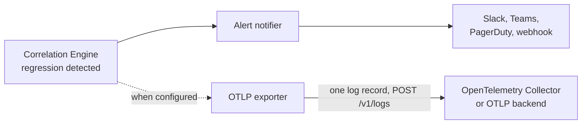

# OpenTelemetry Regression Export (OTLP)

*Emit every detected `PerformanceRegression` as an OTLP log record, so any OpenTelemetry-native backend can consume it without this project's own dashboard API.*

## Overview

When a regression is detected — from either the deploy-triggered or the [periodic](periodic-detection.md) path, regardless of which `SampleSource` fed it — it is sent to the existing [alert notifier](alerting.md) and, when configured, also exported as one OTLP/HTTP **log record**. This is **complementary** to Slack/Teams/PagerDuty alerting, not a replacement; the two are independent, so a failing OTLP endpoint never delays or suppresses an alert (and vice versa).

Only OTLP/HTTP is implemented (binary protobuf or JSON, optional gzip), at the wire level — no gRPC and no OpenTelemetry SDK dependency. The export goes to the standard `POST <endpoint>/v1/logs` of any OpenTelemetry Collector or OTLP-capable backend.



*OTLP export is in addition to the alert, never instead of it.*

## Enabling it

### PostgresWatch (`cmd/manager`)

```yaml
apiVersion: radar.pgregressionradar.io/v1alpha1
kind: PostgresWatch
metadata:
  name: checkout-prod
spec:
  # ...
  otlpExport:
    endpoint: https://otel-collector.observability.svc:4318
    encoding: protobuf        # or json (default: protobuf)
    gzip: true
    timeoutSeconds: 10        # per attempt, 1-120
    headersSecretRef:         # optional; OTEL_EXPORTER_OTLP_HEADERS format
      name: otlp-headers
      key: headers
```

`headersSecretRef` points to a Secret in the PostgresWatch's namespace whose value is `k=v,k2=v2` (for example `authorization=Bearer abc`). Like every Secret a PostgresWatch references, it must carry the [consent label](multi-cluster.md#secret-consent-label) `pg-regression-radar.io/allow-postgreswatch-access: "true"`. Rotating the Secret restarts the watch's worker on the next reconcile.

The endpoint is chosen by whoever can create a PostgresWatch but requested by the manager, so it is held to the same manager-wide outbound policy as alert destinations:

- `http`/`https` only, no embedded credentials (use headers);
- loopback, link-local (including the `169.254.169.254` cloud metadata address) and metadata hostnames are refused;
- when `--alerting-allowed-destinations` is set, the host must be on that allowlist;
- under `--alerting-destination-policy=relay-only`, `spec.otlpExport` is rejected outright.

A violation puts the PostgresWatch in phase `Failed` with the reason in `status.message`; nothing is started.

### Standalone `operator`

```bash
operator --dsn "$POSTGRES_DSN" \
  --otlp-endpoint http://localhost:4318 \
  --otlp-encoding protobuf --otlp-gzip --otlp-timeout 10s
```

Headers come from `--otlp-headers`, or — preferably, to keep credentials out of the process list — the standard `OTEL_EXPORTER_OTLP_LOGS_HEADERS` / `OTEL_EXPORTER_OTLP_HEADERS` environment variables. Export is **only** enabled by `--otlp-endpoint`; ambient `OTEL_EXPORTER_OTLP_ENDPOINT` variables (usually set for a pod's own tracing) are deliberately not honoured. The destination rules above apply to the extent the standalone binary has the corresponding flags; a `localhost` collector sidecar is accepted when no allowlist is set.

### Helm

`otlpExport.*` in `values.yaml`. `otlpExport.headers` is stored in the chart Secret (never rendered into arguments or the CR), and `networkPolicy.egress.otlpCIDRs`/`otlpPorts` opens the matching egress rule.

## What is exported

One log record per regression, in a Resource identifying this project (`service.name=pg-regression-radar`, `service.version`, plus `k8s.namespace.name`, `k8s.cluster.name` and `pg_regression_radar.watch.name` when known) and scope `github.com/joao00001/pg-regression-radar`.

| Log record field | Value |
|---|---|
| `event_name` | `pg_regression_radar.performance_regression` |
| `severity_number` / `severity_text` | `13` / `WARN` |
| `time_unix_nano` | when the change point was detected (falling back to creation time) |
| `observed_time_unix_nano` | export time |
| `body` | human-readable summary, e.g. `Query 123 latency regressed 3.00x (mean 10.00 ms -> 30.00 ms) after deploy otlp-…, confidence 0.97, p-value 0.03` |
| `trace_id` / `span_id` | present when the triggering deploy came from an [OTLP span](otlp-deploy-events.md); links the regression to the deploy trace |

| Attribute | Type | Notes |
|---|---|---|
| `db.system.name` | string | always `postgresql` |
| `db.query.text` | string | truncated query text, when known |
| `pg_regression_radar.regression.name` / `.status` / `.trigger_type` | string | `trigger_type` is `deploy` or `periodic` |
| `pg_regression_radar.query_id` | int | `pg_stat_statements` queryid |
| `pg_regression_radar.confidence` | double | `1 - p_value`; a significance score, not a probability |
| `pg_regression_radar.p_value` | double | Welch's t-test p-value; omitted when the test did not run |
| `pg_regression_radar.latency.before_ms` / `.after_ms` / `.change_factor` | double | |
| `pg_regression_radar.deploy_event_id` | string | when deploy-triggered |
| `pg_regression_radar.detected_change_at` | string | RFC 3339 |
| `pg_regression_radar.external_cause_suspected` | bool | |
| `pg_regression_radar.auto_abort.triggered` / `.error` | bool / string | `.error` only when set |
| `pg_regression_radar.plan_diff_summary` | string | only when plan capture produced one |

Query *text* is already truncated by the collector before it reaches any notifier; the same value is exported. Do not enable the export towards a destination you would not also trust with the Slack alert.

## Delivery guarantees

Export is asynchronous and bounded; it never blocks detection.

- A bounded in-memory queue (256 regressions) feeds one worker. When it is full the regression is **dropped and counted**, rather than growing memory or stalling the poll loop.
- Network errors and `429/502/503/504` responses are retried with exponential backoff (4 attempts in total, first retry after 500 ms), honouring `Retry-After`. Any other non-2xx status — including `400`, `401`, `403`, `404` — is permanent and not retried.
- Redirects are **never followed**, so a collector cannot bounce the request (and its auth headers) to another host.
- On shutdown or when a watch is stopped or reconfigured, queued records are flushed for up to 5 seconds; retries are aborted at that deadline.
- Delivery is at-least-once per detection but not durable: records queued when the process is killed, or still failing after the retries, are lost. The alert notifier and the `PerformanceRegression` resource remain the durable record.

Metric `pg_regression_radar_otlp_export_total{result="success|failed|dropped"}` counts outcomes per exporter; alert on a growing `failed` or `dropped` rate. Each retry is logged at `WARN`, a record abandoned after the last attempt at `ERROR` (both with the endpoint and the cause), and a full queue at `WARN`.

## OpenTelemetry Collector example

A Collector receiving the log records and forwarding them to a logging backend:

```yaml
receivers:
  otlp:
    protocols:
      http:
        endpoint: 0.0.0.0:4318

processors:
  batch: {}

exporters:
  debug:
    verbosity: detailed
  # otlphttp/loki, datadog, ... — any logs exporter

service:
  pipelines:
    logs/regressions:
      receivers: [otlp]
      processors: [batch]
      exporters: [debug]
```

Filter on `event_name == "pg_regression_radar.performance_regression"` (or `attributes["db.system.name"] == "postgresql"`) to route regressions separately from other log traffic.

## Troubleshooting

- **`pg_regression_radar_otlp_export_total{result="failed"}` grows.** Check the operator/manager log for the status code: `401/403` → headers; `404` → the endpoint must be an OTLP/HTTP receiver (port `4318`, not the gRPC port `4317`); `415` → try `encoding: json` or `protobuf` to match what the backend accepts.
- **PostgresWatch is `Failed` with `spec.otlpExport.endpoint rejected`.** The endpoint is loopback/metadata or not on the allowlist; use an in-cluster Service DNS name or IP.
- **`... has no key` / consent-label error.** The headers Secret needs the key named in `headersSecretRef.key` and the consent label.
- **`dropped` is non-zero.** The collector is slower than detection for a sustained period; investigate the collector, or lower detection volume.
