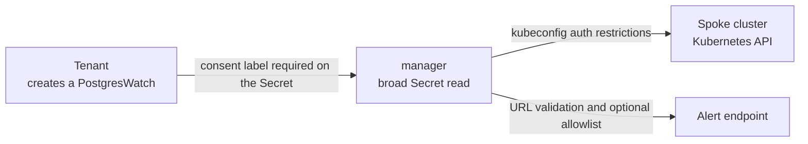

# Security Model & Threat Model

*Formal threat model and security contract for who may configure pg-regression-radar, which Secrets it may read, and where it may connect in each supported security profile.*

## Overview

This page defines the security contract for `cmd/manager` mode: trust assumptions, protected assets, authorization boundaries, and profile-specific operational rules. It is intentionally concrete: an administrator should be able to answer (a) who can create each CRD, (b) which Secrets may be read, (c) where the manager may connect, and (d) what changes between `controlled`, `hardened`, and `relay-only`.

The model applies to the Kubernetes/CRD deployment path (`PostgresWatch` + `DeploySource`), including fleet mode via `spec.remoteClusterRef` (and deprecated `spec.remoteClusterSecretRef` for backward compatibility) plus the optional `spec.cnpgClusterRef` remote CloudNativePG `Cluster` health check, which reuses the same kubeconfig and trust boundary. It does **not** cover host/OS hardening, cloud IAM design outside Kubernetes, or arbitrary third-party webhook endpoints beyond the controls listed here.



*Each arrow is a trust boundary and is labelled with the control that guards it.*

## Security profiles

| Profile | Intended environment | Trust assumption | Tenancy model | Default recommendation |
|---|---|---|---|---|
| `controlled` | Single-tenant cluster or one trusted platform team | People with namespace write access are trusted operators | Single team or tightly coordinated teams | Good baseline when operational simplicity matters most |
| `hardened` | Shared cluster with multiple teams and sensitive production workloads | CRD authors are **not** automatically trusted to select any Secret/destination | Multi-team, namespace-isolated | Recommended for most production shared clusters |
| `relay-only` | Highly restricted environments (regulated or strict network controls) | Manager should not be used as a direct cross-cluster credential broker | Multi-team with central integration point | Use when direct DB Secret access by manager is not acceptable |

### `controlled` profile (single-tenant, trusted teams)

Supported:

- `PostgresWatch` and `DeploySource` can be created by trusted team operators in their namespace.
- `spec.remoteClusterRef` is preferred; deprecated `spec.remoteClusterSecretRef` is allowed only when the same trusted team also owns the remote-cluster kubeconfig lifecycle.
- Alert destinations may be team-defined, still subject to built-in URL checks.

Practical example:

- A single platform team runs one cluster, owns all namespaces, and uses one manager instance to watch multiple Postgres clusters (including one remote spoke) using team-managed kubeconfig Secrets.

### `hardened` profile (multi-team, sensitive production)

Supported:

- Teams may create `PostgresWatch`/`DeploySource` only in their own namespace.
- Only approved identities may apply the Secret consent label (`pg-regression-radar.io/allow-postgreswatch-access=true`).
- Remote-cluster references are allowed only for platform-approved kubeconfig Secrets.
- Alert destinations are restricted with `--alerting-allowed-destinations` and the `allowlist` destination policy. Set `--alerting-destination-policy=allowlist` alongside a non-empty `--alerting-allowed-destinations` so every reconciled watch fails fast if its URL is not pre-approved — see [Alerting: destination policies](alerting.md#destination-policies).

Practical example:

- Team A can create a `PostgresWatch`, but cannot force the manager to read Team B's Secret because unlabeled Secrets are rejected and consent labeling is centrally restricted by admission policy.

### `relay-only` profile (highly restricted)

Supported:

- Teams may define correlation intent (`PostgresWatch` + `DeploySource`) through platform-approved templates/policies, but should not manage remote-cluster references directly.
- Tenant-managed remote-cluster references (`spec.remoteClusterRef`/deprecated `spec.remoteClusterSecretRef`) are disallowed by policy (admission/RBAC convention) unless approved as break-glass by platform admins.
- Manager network egress is restricted to approved alert relays and required in-cluster APIs.

Not supported (by contract):

- Tenant-managed direct remote-cluster kubeconfig usage.
- Arbitrary tenant-defined external alert endpoints.

Practical example:

- A regulated environment routes all alerts through an internal relay service; teams cannot point `alerting.url` to internet endpoints and cannot attach remote kubeconfigs to watches.
- Configure the manager with `--alerting-destination-policy=relay-only --alerting-destination-policy-relay-url=https://relay.example.com/webhook`. Any `destinationPolicy` or `url` set in a `PostgresWatch` spec is ignored; all alert traffic flows through the single relay. The manager fails at startup if the relay URL is empty, catching misconfigurations before any watches are reconciled — see [Alerting: destination policies](alerting.md#destination-policies).

## Trust model

### Actors

| Actor | Typical identity | Trusted for | Not trusted for (without extra controls) |
|---|---|---|---|
| Cluster administrator | Cluster-admin / platform SRE | Cluster-wide RBAC, admission policy, namespace boundaries | Day-to-day app release intent in every team |
| Team lead | Namespace admin role | Creating team-scoped watches/sources, selecting approved Secrets | Global Secret brokering across namespaces/teams |
| Application developer | CI/CD or developer role with limited namespace write | Proposing `DeploySource` changes for owned app | Choosing privileged Secrets or remote kubeconfigs |
| Operator (manager ServiceAccount) | `manager-role` ClusterRole binding | Reading referenced Secrets and reconciling CRDs within granted RBAC | Making trust decisions beyond configured labels/RBAC/policies |

### Protected assets

| Asset | Why sensitive |
|---|---|
| PostgreSQL DSN credentials (`dsnSecretRef`) | Direct database access; may include high-privilege roles |
| Remote-cluster kubeconfig Secrets (`remoteClusterRef` registry entry or deprecated `remoteClusterSecretRef`) | Delegates Kubernetes API access to spoke clusters |
| Alert destination configuration (`alerting.url`, webhook targets) | Potential data exfiltration/SSRF route |
| Deployment metadata (`DeployEvent`, app/revision/cluster mapping) | Operational intelligence about release cadence and topology |
| The dashboard's saved profile (layout edits, panel queries, time ranges) | Holds no credentials, but its panel titles, descriptions and queries name applications, namespaces and tables, so it is topology metadata of the same kind as deploy metadata, on the user's disk. See [What the dashboard saves](#what-the-dashboard-saves-and-how-it-is-protected) |

### Trust boundaries

| Boundary | Crossing event | Main risk | Mitigation |
|---|---|---|---|
| Tenant authoring CRDs -> manager reading Secrets | A `PostgresWatch` references `dsnSecretRef` plus `remoteClusterRef`/deprecated `remoteClusterSecretRef` | Confused deputy (manager reads Secrets broader than author's own rights) | Secret consent label check before use ([Multi-Cluster: Secret consent label](multi-cluster.md#secret-consent-label)) |
| Hub cluster -> spoke cluster Kubernetes API | Kubeconfig from `remoteClusterRef` registry (or deprecated `remoteClusterSecretRef`) is used to build remote client, to read `dsnSecretRef` and, when `cnpgClusterRef` is set, a CloudNativePG `Cluster`'s status | Credential/plugin abuse, proxy-based traffic redirection | Kubeconfig auth restrictions (`exec`, `auth-provider`, `proxy-url` rejected) ([Multi-Cluster: Kubeconfig restrictions](multi-cluster.md#kubeconfig-restrictions)) |
| Dashboard page -> dashboard server (the one write) | The page saves the user's edits with `PUT`/`DELETE /dashboard/profile`; a page on another site, or another process, tries the same | Overwriting or reading someone's profile; writing outside the data directory; using a forged request from a browser tab | Fixed path, marker header that forces a CORS preflight the server never answers, same-origin `Origin`/`Sec-Fetch-Site`, `Host` check, size limit, validation before write; saving off under `--insecure-listen` ([below](#what-the-dashboard-saves-and-how-it-is-protected)) |
| Manager -> external alert endpoint | Notifier sends payloads to configured destination | SSRF/data exfiltration to unsafe endpoints | URL validation + optional strict allowlist ([Alerting: Destination validation](alerting.md#destination-validation-ssrf-hardening)) |

### Operator responsibilities vs Kubernetes responsibilities

| Concern | Kubernetes platform is responsible for | pg-regression-radar operator is responsible for |
|---|---|---|
| Who can create/modify CRDs | RBAC/admission for `PostgresWatch` and `DeploySource` | Respecting CRD intent, not bypassing API authorization |
| Secret ownership and eligibility | Secret creation rights, namespace isolation, consent-label policy | Refusing unlabeled Secrets before reading contents |
| Remote cluster access scope | Issuing least-privilege kubeconfigs in spoke clusters | Rejecting unsafe kubeconfig auth/proxy mechanisms |
| Network destination control | NetworkPolicy, egress firewall, DNS policy | Rejecting obviously unsafe alert destinations; honoring allowlist config |

## Permission matrix (security contract)

| Capability | `controlled` | `hardened` | `relay-only` |
|---|---|---|---|
| Create `PostgresWatch` resource | ✓ Cluster admin, Team lead | ✓ Team lead in own namespace; Cluster admin | ✓ Team lead in own namespace; Cluster admin |
| Create/modify `DeploySource` resource | ✓ Cluster admin, Team lead, App developer (team policy) | ⚠ Team lead/App developer in own namespace only, with stricter admission | ⚠ Team lead/App developer in own namespace only, often templated via platform workflow |
| Manager reads DSN Secret (`spec.dsnSecretRef`) | ✓ If Secret is consent-labeled | ✓ If Secret is consent-labeled and label assignment is restricted | ⚠ Prefer platform-managed relay/credentials; direct reads only for explicitly approved Secrets |
| Configure remote cluster reference (`spec.remoteClusterRef` or deprecated `spec.remoteClusterSecretRef`) | ✓ Trusted team operators or Cluster admin | ⚠ Platform-approved identities only; tenant use gated by policy | ✗ Tenant-managed remote references; break-glass platform admin only |

### Which Secrets may be read

The manager may read only Secrets that satisfy **all** of the following:

1. Are reachable through manager RBAC in the hub cluster (`config/rbac/role.yaml` for hub reads).
2. Are explicitly consent-labeled: `pg-regression-radar.io/allow-postgreswatch-access=true`.
3. When remote-cluster mode is used, are reachable by the kubeconfig identity in the spoke cluster.

In short: label consent is required, RBAC scope still applies, and remote access is additionally constrained by spoke-side RBAC.

### Where the manager may connect

| Connection target | `controlled` | `hardened` | `relay-only` |
|---|---|---|---|
| Hub Kubernetes API | Required | Required | Required |
| Spoke Kubernetes API via `remoteClusterRef` (or deprecated `remoteClusterSecretRef`) | Allowed | Allowed only for platform-approved references | Disallowed by default |
| PostgreSQL endpoint from DSN | Allowed per referenced Secret | Allowed per approved Secret + tighter namespace policy | Usually via approved internal path only |
| Alert endpoints (`alerting.url`) | Team-defined with built-in validation | Restricted allowlist + network egress controls | Internal relay destinations only |

### Reading the Postgres log (optional, off by default)

`attribution.arms` reads the database's JSON log, either through the Kubernetes `pods/log` subresource or from a file. A Postgres log can hold anything the server logs, so the access is broad, and the chart grants it only with `manager.arms.rbacEnabled: true` (cluster-wide `get`/`list` on pods and `get` on `pods/log`; narrow it to a `Role` in the database's namespace if you can). What the manager keeps from it: when a statement ran, its `application_name`, its `query_id` and its duration. It does not keep the statement text or the bind parameters, a line over 1 MiB is skipped, and the number of distinct `application_name`/`query_id` pairs is bounded so a client cannot grow the manager's memory by putting a request id in its `application_name`. The `file` path comes from the PostgresWatch, so whoever may create one chooses a file the manager reads: it must be an absolute, clean path to a regular file, and what is read from it is only parsed as log lines, but treat the right to create a PostgresWatch with `arms.file` as the right to point the manager at any file it can open, or use `podLogs`. It writes nothing to the database or the cluster.

### The Observe API and the dashboard (read-only)

The manager serves a read-only Observe API (`/observe/v1`) on `--observe-addr`, `127.0.0.1:8083` by default, so it is reachable only from inside the pod. There is no Service or Ingress for it and the chart adds none. The [dashboard](dashboard.md) reaches it through a Kubernetes port-forward with the user's own kubeconfig, which needs `get` on `leases`, `get` on `pods` and `create` on `pods/portforward` in the manager's namespace; whoever lacks that permission cannot see it.

- Nothing in the API changes cluster state. It serves only deploys in `attribution.actuate.namespaces` when that list is set, on every endpoint including the event stream.
- Normalised SQL text is off unless both the manager (`--observe-allow-queries`) and the dashboard (`--show-queries`) ask for it.
- History in Postgres (`--observe-history=postgres`) reads its DSN from a file (`--observe-history-dsn-file`, for example a mounted Secret), never from a flag.
- The dashboard binds to loopback, checks the `Host` header, accepts only GET and HEAD (and the one save request described next), and sets a strict Content-Security-Policy. It has no sign-in, so `--insecure-listen` exposes it to anyone who can reach the address; for that reason it also turns saving off.
- It is read-only toward the cluster and the radar. The only thing it writes is the user's own profile file, in its data directory, described in the next section.

#### What the dashboard saves, and how it is protected

The dashboard keeps the user's edits between runs in one small JSON file per dashboard source, `dashboard-default.json` or `dashboard-file-<id>.json`, in `--data-dir` (default `pg-regression-radar/dashboard` under the user's configuration directory). See [Dashboard: your edits are kept between runs](dashboard.md#your-edits-are-kept-between-runs) for how a user works with it.

**What the file holds:** the layout (board and panel ids, types, positions and sizes), each panel's settings, its title, description and `query` text, the time range of each board, and a fingerprint of the layout it was edited on. Titles, descriptions and queries are text the user typed, so they can name applications, namespaces and tables.

**What it never holds:** credentials of any kind (the kubeconfig, DSNs, tokens, the history DSN), Observe API data (deploys, evaluations, series, decisions), normalised SQL text, or anything the manager serves. The page does not put such data in the profile and the server accepts only the fields listed above. Do not type secrets into a title or description: they are stored in clear text and shown on the page.

| Threat | How it is handled | Residual risk |
|---|---|---|
| A web page on another site makes the user's browser write or read the profile | A write needs the `X-Requested-By: pgrr-dashboard` header, which a browser sends cross-site only after a preflight the server never answers; `Origin` and `Sec-Fetch-Site`, when present, must be this page's own; the `Host` check refuses DNS-rebound names for reads and writes; no CORS headers are sent | Browsers and extensions that do not enforce CORS are outside this model |
| Another local user reads the file | Directory created 0700 and file 0600; the file holds no credentials | An **existing** directory keeps its own permissions (a shared or world-readable `--data-dir` exposes the file's contents, not secrets); keep the directory private |
| Another local user replaces or tampers with the file | Everything read from the file is re-validated: known fields only, a layout that passes the dashboard-file validator, plain ranges, at most 256 KiB; the page sanitises it again and draws all text as text (no HTML), under a strict Content-Security-Policy; an unusable file is reported and left alone until the next save | Someone who can write the user's configuration directory can change what the user's own dashboard shows (hide a panel, change a title or query); they can also edit the user's other files |
| Remote users on an exposed dashboard overwrite the profile | `--insecure-listen` turns saving off (the page then keeps edits in the browser) and the command says so | None for the file; the page itself is still readable by anyone who can reach it |
| A request names a file to write, or escapes the directory | The path is fixed (`dashboard-<key>.json` in the data directory; the key is `default` or a digest of the `--config` path); no request carries a path; writes go to a temporary file in the same directory and are renamed over it | A data directory that is itself a symlink or a mount points where the user pointed it |
| A large or malformed body fills the disk or crashes the server | At most 256 KiB, a single JSON object, validated before anything is written, one file per source | The user can still fill their own disk by other means |
| The file is copied by backup or file-sync software | Nothing in it is a credential | It is copied like any other file in the configuration directory; point `--data-dir` somewhere excluded, or use `--no-save`, where topology names must not leave the machine |

**Retention and deletion.** The file lives until it is removed; there is no expiry and no history. *Undo my edits* drops the layout from it, and deleting the file (or the data directory) resets everything. `--no-save` writes nothing to disk and keeps edits in the browser only. In a container or on a read-only file system, an unwritable directory is reported at start and the dashboard falls back to the browser; mount a volume and pass `--data-dir` to keep edits.

### Actions on the outside world (optional, off by default)

Two optional features of the [attribution engine](attribution-engine.md) can change things outside the manager. Both need `attribution.mode: enforce` on the watch, so a default install does neither.

| Capability | What it can do | What it cannot do | Stop it |
|---|---|---|---|
| `attribution.actuate` | Set `spec.paused` or `status.abort` on an Argo Rollouts rollout reported by an `argo-rollouts` `DeploySource`, once per deploy | Create, delete, scale, resume or roll back a Rollout; touch any other kind | Set `actuate.enabled: false`, or annotate the `PostgresWatch` with `pg-regression-radar.io/actuation-paused="true"` (no restart). Without `manager.autoAbort.rbacEnabled` the RBAC is not even granted |
| `attribution.revert` | Open a **draft** pull request that reverts the commit behind a convicted deploy, at most `maxPerDay` per day, using the token in `tokenSecretRef` | Merge or approve it. It creates a revert branch and a draft pull request (GitHub's `revertPullRequest`), and only for the merge commit of a merged pull request | Remove `revert`, or revoke the token. Give the token only the access to open pull requests on that one repository |

Every pause and abort is recorded in the action ledger (`GET /api/v1/attribution/actions`) and in `pg_regression_radar_attribution_actions_total`, and an abort that did not help counts toward a circuit breaker that stops further action. The endpoints that serve the verdict and the ledger are read-only and unauthenticated: expose them only inside the cluster (a ClusterIP Service) and restrict them with a NetworkPolicy.

## Supported scenarios and limitations

### Namespace isolation assumptions

- `PostgresWatch` and `DeploySource` are namespace-scoped resources; this model assumes teams do **not** get arbitrary write across other teams' namespaces.
- In fleet mode, default remote Secret lookup uses the same namespace name as the watch unless `remoteNamespace` is explicitly set ([Multi-Cluster: What actually happens on reconcile](multi-cluster.md#what-actually-happens-on-reconcile)).

### Multi-tenancy restrictions by profile

- `controlled`: relies mostly on trust and process; technical controls are still present but may be less restrictive operationally.
- `hardened`: requires admission/RBAC reinforcement around consent label use and remote reference ownership.
- `relay-only`: intentionally removes tenant-controlled remote references and external destination freedom.

### Scope limits of this model

This document defines the contract for CRD-driven access mediation and manager connection surfaces. It does not guarantee:

- host-level compromise resistance,
- protection from all DNS rebinding variants,
- automatic remote kubeconfig credential rotation,
- full policy examples for every admission controller product.

## Existing security controls and where they live

| Control | Purpose | Documented in | Implemented in |
|---|---|---|---|
| Secret consent label (`pg-regression-radar.io/allow-postgreswatch-access=true`) | Prevent confused-deputy Secret reads from arbitrary references | [Multi-Cluster: Secret consent label](multi-cluster.md#secret-consent-label), [Configuration Reference](configuration.md#postgreswatch-spec-fields) | `internal/controller/secret_consent.go`, enforced in `internal/controller/postgreswatch_controller.go` |
| Optional admission policy restricting consent label setters | Ensure only approved identities can opt Secrets in | [`docs/policies/kyverno-consent-label-policy.yaml`](policies/kyverno-consent-label-policy.yaml) | Cluster admission engine (example policy file in repo) |
| Kubeconfig restrictions for remote cluster refs | Block `exec` plugins, `auth-provider`, and `proxy-url` in tenant-supplied kubeconfigs | [Multi-Cluster: Kubeconfig restrictions](multi-cluster.md#kubeconfig-restrictions) | `internal/controller/remote_client.go` (`validateKubeconfigAuth`) |
| Alert destination validation and allowlist support | Reduce SSRF/exfiltration risk for alerting destinations | [Alerting: Destination validation](alerting.md#destination-validation-ssrf-hardening) | `internal/alerting` notifier construction and destination validation path |
| Webhook shared-secret authentication | Prevent unauthenticated deploy-event injection | [Deploy Sources & Webhooks: Webhook authentication](webhooks.md#webhook-authentication) | `internal/cli/ingester.go` (`X-Webhook-Token` constant-time check) |
| Dashboard profile write protection (marker header, same-origin check, fixed path, validation, 0600 file, saving off under `--insecure-listen`) | Keep the dashboard's one write from being forged, redirected or abused | [Security model: What the dashboard saves](#what-the-dashboard-saves-and-how-it-is-protected), [Dashboard](dashboard.md#your-edits-are-kept-between-runs) | `internal/dashboard/profile.go`, `internal/dashboard/server.go`, `internal/cli/dashboard.go` |
| Manager RBAC split (hub Secrets vs spoke kubeconfig rights) | Clarify and constrain what manager SA can do in hub cluster | [Multi-Cluster: RBAC](multi-cluster.md#rbac-two-separate-concerns) | `config/rbac/role.yaml` + spoke-cluster RBAC provided by kubeconfig owner |

## Hardened-mode deployment: admission + RBAC for consent labeling

Use these policy examples to ensure tenants cannot self-approve Secret access by setting
`pg-regression-radar.io/allow-postgreswatch-access=true` themselves.

### Option A: Kyverno policy

1. Apply RBAC example identities:
   ```bash
   kubectl apply -f docs/policies/rbac-consent-labeler-example.yaml
   ```
2. Apply Kyverno policy:
   ```bash
   kubectl apply -f docs/policies/kyverno-consent-label-policy.yaml
   ```
3. Verify enforcement:
   ```bash
   kubectl get cpol restrict-postgreswatch-consent-label
   kubectl describe cpol restrict-postgreswatch-consent-label
   ```

### Option B: Kubernetes ValidatingAdmissionPolicy (CEL)

1. Ensure your cluster supports ValidatingAdmissionPolicy (Kubernetes 1.26+ with feature enabled).
2. Apply RBAC example identities:
   ```bash
   kubectl apply -f docs/policies/rbac-consent-labeler-example.yaml
   ```
3. Apply CEL policy + binding:
   ```bash
   kubectl apply -f docs/policies/validating-admission-policy-consent-label.yaml
   ```
4. Verify enforcement:
   ```bash
   kubectl get validatingadmissionpolicy restrict-postgreswatch-consent-label
   kubectl get validatingadmissionpolicybinding restrict-postgreswatch-consent-label
   ```

### RBAC strategy (least privilege)

- Use a dedicated identity for labeling (`docs/policies/rbac-consent-labeler-example.yaml`).
- Keep tenant `PostgresWatch` authors in roles that exclude Secret mutation (`create`, `update`, `patch`, `delete` on Secrets).
- Treat break-glass labeler identities as audited, short-lived operational paths.
- Policy allowlists in examples match exact Kubernetes usernames (`system:serviceaccount:<namespace>:<name>`); adapt to group-based checks if your platform standard prefers groups.

### Validate policy behavior with `kubectl --dry-run=server`

!!! note
    Replace `<ns>` with a namespace where your policy applies.

Attempt without consent label (should be admitted; controller will still refuse to use it):

```bash
cat <<'EOF' | kubectl apply -n <ns> --dry-run=server -f -
apiVersion: v1
kind: Secret
metadata:
  name: dry-run-without-consent
type: Opaque
stringData:
  dsn: postgres://example
EOF
```

Attempt with consent label as unauthorized identity (should be denied):

```bash
cat <<'EOF' | kubectl apply -n <ns> --as=system:serviceaccount:team-a:app-operator --dry-run=server -f -
apiVersion: v1
kind: Secret
metadata:
  name: dry-run-unauthorized-labeler
  labels:
    pg-regression-radar.io/allow-postgreswatch-access: "true"
type: Opaque
stringData:
  dsn: postgres://example
EOF
```

Attempt with consent label as approved labeler identity (should succeed):

```bash
cat <<'EOF' | kubectl apply -n <ns> --as=system:serviceaccount:platform-security:secret-consent-labeler --dry-run=server -f -
apiVersion: v1
kind: Secret
metadata:
  name: dry-run-authorized-labeler
  labels:
    pg-regression-radar.io/allow-postgreswatch-access: "true"
type: Opaque
stringData:
  dsn: postgres://example
EOF
```

### Troubleshooting common misconfigurations

- **Policy appears inactive:** ensure Kyverno is healthy (`kubectl -n kyverno get pods`) or that ValidatingAdmissionPolicy feature is enabled on API server.
- **Unexpected deny:** confirm caller identity (`kubectl auth whoami`) and compare to the allowlist in the policy file.
- **Unauthorized users can still label:** verify their RBAC grants do not include Secret mutation verbs.
- **Manager still rejects a Secret:** confirm exact label key/value is present:
  `pg-regression-radar.io/allow-postgreswatch-access=true`.

## See also

- [Multi-Cluster (Fleet) Mode](multi-cluster.md) — remote-cluster kubeconfig flow, trust boundaries, and operational considerations.
- [Configuration Reference](configuration.md) — `PostgresWatch` and `DeploySource` fields used in this contract.
- [Alerting](alerting.md) — destination validation, allowlist behavior, and SSRF caveats.
- [Deploy Sources & Webhooks](webhooks.md) — webhook authentication and source integration surface.
- [Roadmap](roadmap.md) — where this formal model fits in the security roadmap.
